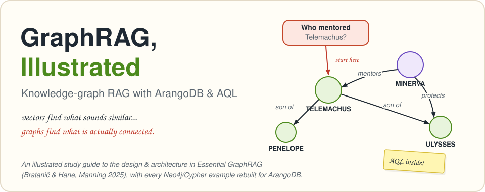
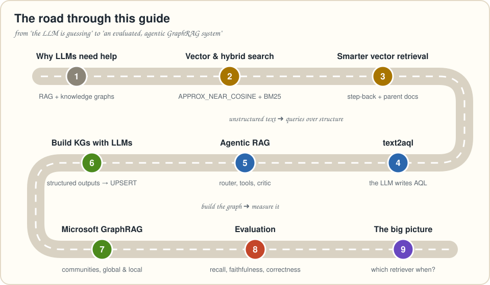

# GraphRAG, Illustrated

**An illustrated, conversational study guide to *Essential GraphRAG*, with every Neo4j/Cypher example rebuilt on ArangoDB and AQL.**

*Essential GraphRAG* (Tomaž Bratanič & Oskar Hane, Manning 2025) builds knowledge-graph RAG from scratch: vector and hybrid search, query rewriting, text-to-query generation, agents, LLM-built knowledge graphs, Microsoft's GraphRAG and evaluation. This guide retells the book's **design and architecture** chapter by chapter in a visual, talk-to-you style. Then it rebuilds every example on **ArangoDB 3.12** with **AQL**, so documents, graph, full-text search and vectors all live in one database and one query language.

* **33 SVG diagrams** that draw the mechanism (where data flows and what each step adds), not just boxes with names.
* **A voice that talks to you and gives you things to do**: 🧠 Brain Benders, ✏️ Pencil Time exercises with fold-out solutions, 🙋 Q&As, ⚠️ Watch Out! traps, 🎙️ Tonight's Talk debates and 📌 one-screen Key Takeaways.
* **Runnable Python + AQL for every chapter**, plus a bonus MCP server, a Cypher ⇄ AQL phrasebook and an AQL linter generated from ArangoDB's own grammar.

## A taste

Here's the whole idea in one AQL query: find text by *meaning*, then hop along the graph to *hard facts*.

```aql
FOR article IN articles
  SORT APPROX_NEAR_COSINE(article.embedding, @question_embedding) DESC
  LIMIT 3
  FOR company IN 1..1 OUTBOUND article mentions
    FOR ceo IN 1..1 OUTBOUND company has_ceo
      RETURN { article: article.title, company: company.name, ceo: ceo.name }
```

Vectors find what *sounds* similar. The graph finds what is actually *connected*. Chapter 1 builds this toy example, and chapters 2–8 scale it up to real retrievers.

## Contents



| | Chapter | What you'll build on ArangoDB | Code |
|---|---|---|---|
| 0 | [How to use this guide](book/00-how-to-use-this-guide.md) | the recurring boxes, setup, and how the chapters map to the book | |
| 1 | [Why your LLM needs a memory it can trust](book/01-improving-llm-accuracy.md) | LLM limits, fine-tuning vs. RAG, knowledge graphs, the ArangoDB data model, AQL's three basic shapes | |
| 2 | [Vector similarity search & hybrid search](book/02-vector-and-hybrid-search.md) | chunks and embeddings, a vector index, `APPROX_NEAR_COSINE`, an ArangoSearch view with BM25, hybrid fusion (max-normalized and RRF) | [`ch02`](code/ch02_vector_hybrid.py) |
| 3 | [Smarter vector retrieval](book/03-advanced-vector-retrieval.md) | step-back prompting, a parent/child document graph, hypothetical questions | [`ch03`](code/ch03_advanced_vector.py) |
| 4 | [text2aql: let the LLM write the query](book/04-text2aql.md) | schema sampling, few-shot examples, terminology mapping, safe execution with retries | [`ch04`](code/ch04_text2aql.py) |
| 5 | [Agentic RAG: a router, some tools and a critic](book/05-agentic-rag.md) | tool routing, AQL template tools, query updating, an answer critic, the same tools as an MCP server | [`ch05`](code/ch05_agentic_rag.py) · [`mcp`](code/ch05_mcp_server.py) |
| 6 | [Building knowledge graphs with LLMs](book/06-building-knowledge-graphs.md) | Structured Outputs to `UPSERT`, an idempotent contract graph, entity resolution, graph-narrowed search over clauses | [`ch06`](code/ch06_contract_kg.py) |
| 7 | [Microsoft's GraphRAG, rebuilt on ArangoDB](book/07-microsoft-graphrag.md) | entity extraction with gleanings, summaries, Louvain communities, community reports, global (map-reduce) and local search | [`ch07`](code/ch07_ms_graphrag.py) |
| 8 | [Evaluating your RAG system](book/08-evaluation.md) | a benchmark whose ground truth is AQL, plus context recall, faithfulness and answer correctness | [`ch08`](code/ch08_evaluation.py) |
| 9 | [The big picture](book/09-the-big-picture.md) | which retriever for which question, a reference architecture, GraphRAG pipeline vs. graph + MCP, a production checklist | |
| A | [The ArangoDB environment](book/appendix-a-arangodb-environment.md) | Docker, the web UI, the Movies dataset, users and permissions, licensing | [`load_movies`](code/load_movies.py) |
| B | [Cypher ⇄ AQL phrasebook](book/appendix-b-cypher-to-aql.md) | side-by-side reading, writing and index syntax, and the semantics that differ | |
| C | [Translation notes and errata](book/appendix-c-translation-notes.md) | every Neo4j → ArangoDB decision, small errata found in the book, and how this guide was verified | |

## Quick start

You'll need Docker and Python 3.10+.

```bash
git clone https://github.com/TheGanesh/graphrag.git
cd graphrag/code
docker compose up -d                        # ArangoDB 3.12.12 with vector indexes, UI on http://localhost:8529
python -m venv .venv && source .venv/bin/activate
pip install -r requirements.txt
cp .env.example .env                        # add an OpenAI-compatible API key and model names
python selftest.py                          # checks the guide's AQL against your server, no API key needed
```

Then open [How to use this guide](book/00-how-to-use-this-guide.md) and work forward. [`code/README.md`](code/README.md) lists the command for each chapter. Any OpenAI-compatible endpoint works, including local models through Ollama or vLLM.

## What's in the repo

```text
book/     the guide: chapters 0-9 and appendices A-C, as Markdown that renders on GitHub
images/   the 33 SVG figures; images/src/ holds the Python that draws them
code/     runnable Python + AQL for every chapter, a self-test and a small benchmark
tools/    aql-lint: checks every AQL query in the repo against ArangoDB's real grammar
```

To redraw the figures, run `python images/src/figures.py` for all of them, or pass file names such as `ch07-pipeline.svg` to redraw only those.

## How the AQL was checked

ArangoDB couldn't be run where this guide was written, so the queries were checked in three other ways. Run the fourth yourself.

1. **Syntax.** Every query in `book/`, `code/` and the benchmark parses with a parser generated from ArangoDB 3.12.12's own grammar, and every function name exists in that release ([`tools/aql-lint`](tools/aql-lint/README.md)).
2. **Plumbing.** Every chapter script was dry-run end to end against a fake database that rejects missing *and* unused bind parameters, with a fake LLM.
3. **Semantics.** Each feature was checked against the official ArangoDB 3.12 documentation.
4. **Your turn.** `python code/selftest.py` runs the queries against a real server and compares known answers. If something fails on your version, open an issue.

Details are in [Appendix C](book/appendix-c-translation-notes.md#verification-used-for-this-guide).

## Credits

* **The book:** *Essential GraphRAG: Knowledge Graph-Enhanced RAG* by Tomaž Bratanič and Oskar Hane, [Manning, 2025](https://www.manning.com/books/essential-graphrag). The authors' own notebooks (on Neo4j) are at [tomasonjo/kg-rag](https://github.com/tomasonjo/kg-rag). Read the book: it has the depth, context and voice this guide only summarizes.
* **Microsoft GraphRAG:** Edge et al., [*From Local to Global: A Graph RAG Approach to Query-Focused Summarization*](https://arxiv.org/abs/2404.16130) (2024).
* **Data**, downloaded at run time and not redistributed here: the [Einstein patents paper](https://arxiv.org/abs/1709.00666) (arXiv 1709.00666), *The Odyssey* ([Project Gutenberg #1727](https://www.gutenberg.org/ebooks/1727)) and Neo4j's public [Movies script](https://github.com/neo4j-graph-examples/movies). The contract in `code/data/` is a fictional sample.

This is an independent, unofficial study companion. It isn't affiliated with or endorsed by the authors, Manning, Neo4j or Arango. The text, diagrams and code are original: the book's ideas are summarized in new words, and no text, figures or listings are copied from it. Product names are trademarks of their owners.
