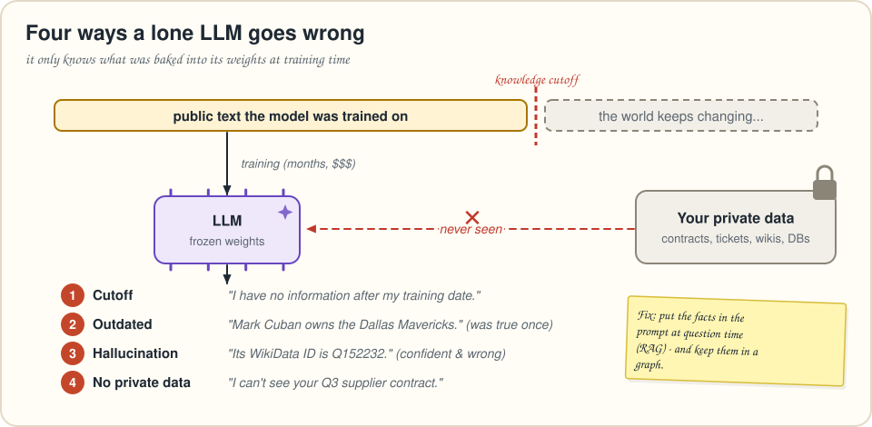
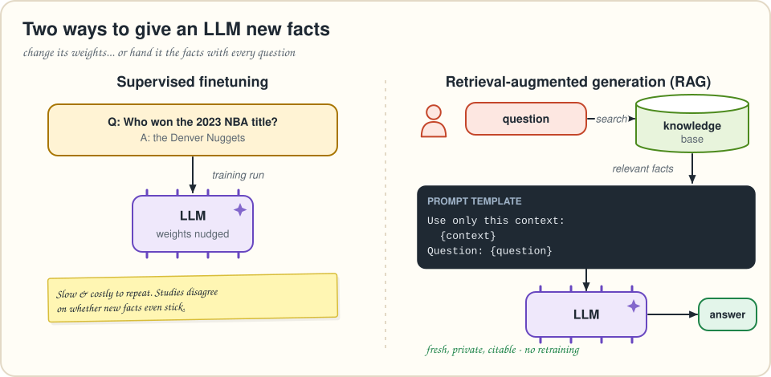
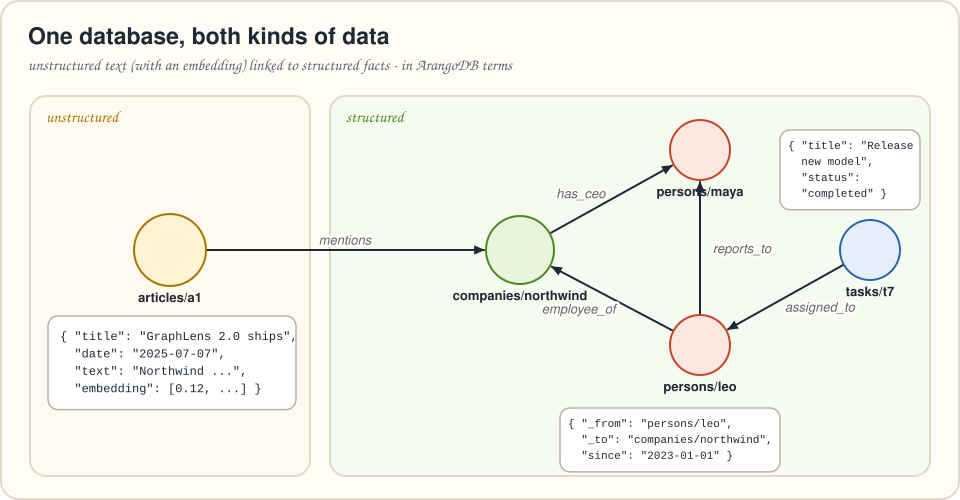

# Chapter 1 · Why your LLM needs a memory it can trust

> *Summarizes* Essential GraphRAG *chapter 1, "Improving LLM accuracy." Neo4j concepts are translated to ArangoDB.*

Ask a chatbot who owns the Dallas Mavericks and you may get a fluent, confident answer that stopped being true a while ago. Ask it for an obscure identifier and it may *invent* one with the same confidence. Ask it about your company's supplier contract and it has no idea, because it has never seen it.

None of this is a bug in one model. It follows from how LLMs work. This chapter covers why, and why the book's answer, **retrieval-augmented generation (RAG) backed by a knowledge graph**, fixes most of it.

---

## How does an LLM "know" anything?

An LLM is a transformer trained to **predict the next token**. Feed it "Never gonna" and it continues with the most likely words, because it has seen that pattern many times.

Training at this scale gives LLMs two impressive abilities:

* **Instruction following.** "Write a haiku about graph databases in a pirate voice" works, even though that sentence never appeared in the training data.
* **Broad general knowledge.** Ask about the first moon landing and you get a correct answer.

The catch is that **there is no fact table inside the model.** The "knowledge" is spread across billions of learned weights. When you ask about the moon landing, the model isn't looking anything up. It's producing text that is statistically consistent with what it saw. Usually that matches reality. Sometimes it doesn't, and the model can't tell the difference.



## Four ways a lone LLM goes wrong

| # | Failure | What happens | Why |
|---|---|---|---|
| 1 | **Knowledge cutoff** | It knows nothing after its training data ends. | Training stopped at some date. |
| 2 | **Outdated information** | It answers with something that *used to* be true (e.g. an old owner of a sports team). | The world changed and the weights didn't. |
| 3 | **Pure hallucination** | It produces plausible but fabricated facts, such as fake legal citations or a WikiData ID that belongs to an unrelated film. | It predicts *likely-sounding* tokens, not *true* ones. Identifiers, URLs and citations are especially risky. |
| 4 | **No private data** | It can't answer about your contracts, tickets or org chart. | That data was never public, so it was never in training. |

The book also lists other limitations (bias, shallow understanding, **prompt injection**, inconsistent answers to the same question) but deliberately focuses on *factual accuracy*. So does this guide.

> [!IMPORTANT]
> 🧠 **Brain Bender.** Look at the four failures again. Which ones would go away if you could retrain the model every night? Which ones would *not*? Hold that thought for the next section.

---

## Two ways to give an LLM new facts



### Option 1: change the weights (supervised finetuning)

Training a chat model happens in stages:

1. **Pretraining.** The model reads trillions of tokens and learns language by predicting the next word. This takes months on thousands of GPUs.
2. **Supervised finetuning (SFT).** It learns to be a helpful assistant from curated prompt→response examples.
3. **Reward modeling.** It learns to tell good answers from bad ones.
4. **Reinforcement learning.** It improves from feedback.

Pretraining is far too expensive to repeat nightly, so the hope was to sneak new facts in through **SFT**: show the model "Q: Who won the 2023 NBA championship? A: the Denver Nuggets" and hope it remembers. The research is mixed. Some studies found finetuning improves factuality, while others found models **struggle to learn genuinely new facts** this way. The authors conclude that relying on finetuning for facts in production is risky.

### Option 2: hand it the facts (RAG)

**Retrieval-augmented generation** keeps the model as it is and changes the *prompt*. There are two stages:

1. **Retrieval.** When a question arrives, search a knowledge base for relevant information.
2. **Augmented generation.** Paste that information into the prompt and ask the model to answer *from it*.

The LLM's job changes from "remember everything" to "read this and answer". That's a task LLMs are very good at. The user just asks a question, and the retrieval happens behind the scenes. ChatGPT's web search works the same way: it searches, reads the results, then answers.

```text
Use only the context below to answer.
Context:
{context}            <- filled in by the retriever
Question:
{question}           <- the user's question
```

> [!IMPORTANT]
> 🧠 **Brain Bender, answered.** Nightly retraining would *help* with 1 and 2 (cutoff and staleness) and with 4 if you trained on private data, but it would still be slow, costly and unreliable, and it would do nothing for 3. RAG addresses 1, 2 and 4 directly, and it reduces 3 because the answer is grounded in text you supplied and can cite. It reduces hallucinations; it doesn't eliminate them.

### 🎙️ Tonight's Talk: Finetuning vs. RAG

> **Finetuning:** I make the model *smarter*. The knowledge goes right into the weights!
>
> **RAG:** For a few weeks, maybe. Then the facts change and you're back on the GPU cluster.
>
> **Finetuning:** You fake it. You just paste text into prompts.
>
> **RAG:** And I can show *which* text I used. Can you point to the weight that stores "Denver Nuggets"?
>
> **Finetuning:** …I'm still great at teaching *style* and *task format*.
>
> **RAG:** Agreed. Teach the model *how* to answer, and let me supply *what* to answer with.

---

## Why a knowledge graph is a great place to keep the facts

RAG needs a knowledge base. Most early RAG systems used a vector store full of text chunks. The book argues for a **knowledge graph**: entities (nodes) connected by relationships, where each can carry properties. A graph can hold **both kinds of data in one place**:

* **Unstructured**: article text plus its embedding, which is great for fuzzy, open-ended questions.
* **Structured**: employees, companies, tasks, statuses and dates, which is required for *precise* questions.



Questions like "How many tasks are completed?" or "Who reports to Maya?" are **filter, count and aggregate** questions. Text embeddings are built for *similarity*, not counting. Without structure you'd have to read every document and hope the LLM adds up correctly. The real advantage comes from the **links between the two worlds**: the article *mentions* the company, so you can go from a fuzzy text match to hard facts in one hop.

### Meet ArangoDB in two minutes

The book uses Neo4j, a native graph database. We'll use **ArangoDB**, a multi-model database: one engine and one query language (**AQL**) for

* **documents** (JSON, like a document store),
* **graphs** (documents linked by *edge documents*),
* **full-text search** (ArangoSearch views with BM25 ranking), and
* **vector search** (vector indexes with `APPROX_NEAR_COSINE`, since v3.12.4).

That's exactly the mix GraphRAG needs: chunks, embeddings, entities, relationships and search, all queryable together.


> [!NOTE]
> 🔄 **Translation Station.** A Neo4j *label* such as `:Person` becomes a **document collection** (`persons`). A *relationship type* such as `ACTED_IN` becomes an **edge collection** (`acted_in`), whose documents carry `_from` and `_to`. Every document has a `_key` and an `_id` = `collection/_key`. That's most of what you need.

AQL reads like a small programming language: you **loop** over things, **filter**, and **return**. Here are the three shapes you'll see all through this guide, on the toy graph above:

```aql
// 1. Documents: who is the CEO of Northwind?
FOR ceo IN 1..1 OUTBOUND "companies/northwind" has_ceo
  RETURN ceo.name
```

```aql
// 2. Graph + aggregation: how many completed tasks are assigned to Leo?
FOR task IN 1..1 INBOUND "persons/leo" assigned_to
  FILTER task.status == "completed"
  COLLECT WITH COUNT INTO completed
  RETURN completed
```

```aql
// 3. GraphRAG in one query: find articles by meaning, then hop to hard facts
FOR article IN articles
  SORT APPROX_NEAR_COSINE(article.embedding, @question_embedding) DESC
  LIMIT 3
  FOR company IN 1..1 OUTBOUND article mentions
    FOR ceo IN 1..1 OUTBOUND company has_ceo
      RETURN { article: article.title, company: company.name, ceo: ceo.name }
```

Read `FOR v IN 1..1 OUTBOUND start edges` as "walk exactly one hop along `edges`, in the direction they point, starting at `start`, and call where you land `v`." `INBOUND` walks against the arrows and `ANY` ignores direction. `@question_embedding` is a **bind parameter**: you pass its value separately, so it's never pasted into the query string.

> [!TIP]
> 😌 **Relax.** You don't need to remember AQL syntax yet. Every query in this guide is explained where it first appears, and [Appendix B](appendix-b-cypher-to-aql.md) collects them all.

---

## 🙋 No Such Thing as a Dumb Question

**Q: Do I *need* a graph database for RAG?**
A: No. Plain vector RAG works for many FAQ-style use cases, and chapters 2–3 build exactly that. The graph pays off when questions need *precision* (counts, filters, "which contract?"), *multi-hop* connections, or when you want to explain where an answer came from.

**Q: Is ArangoDB a "vector database"?**
A: It has vector indexes, so it can do vector search. The point is that the vectors sit right next to your documents and graph, so one AQL query can combine "similar to this question" with "connected to that entity".

**Q: The book uses Neo4j. Will the ideas carry over?**
A: Yes. The book is about *patterns*: chunking, hybrid search, query generation, agents, graph construction, community summaries and evaluation. Only the query syntax and a few platform features change. [Appendix C](appendix-c-translation-notes.md) lists every place where the translation needed a decision.

**Q: Doesn't RAG make hallucinations impossible?**
A: No. It reduces them a lot, but the model can still misread or ignore context. That's why chapter 8 measures *faithfulness*.

---

## 📌 Key Takeaways

* LLMs predict likely text. Their knowledge lives in weights, not in a database, so it's **frozen, unverifiable and sometimes invented**.
* The four accuracy problems are **knowledge cutoff, outdated info, hallucination and missing private data**.
* **Finetuning** is a poor way to add facts: slow, costly and unreliable. **RAG** supplies facts in the prompt at question time.
* A **knowledge graph** stores structured facts *and* unstructured text, with explicit links between them. That enables precise, multi-hop and explainable retrieval.
* In **ArangoDB**, labels become collections, relationships become edge documents, and one query language (AQL) covers documents, graphs, full-text and vectors.

## ✏️ Pencil Time

For each question, decide: is **similarity search over text** enough, or do you need **structure**?

1. "What do our support tickets say about login problems?"
2. "How many open tickets does each customer have?"
3. "Which employees work on projects that mention GDPR in their design docs?"
4. "Summarize what the latest article says about our CEO."

<details>
<summary>▸ Solution</summary>

1. **Text is fine.** A fuzzy topic search over unstructured tickets.
2. **Structure.** Group by customer and count, filtered on a status attribute. That's a `COLLECT … WITH COUNT INTO` query.
3. **Both.** Find design docs similar to "GDPR" (vectors), hop to projects, then to employees (graph). This is the GraphRAG sweet spot.
4. **Mostly text**, but "our CEO" is an entity. A graph tells you *who* the CEO is (`has_ceo`), so retrieval can look for articles that mention that person.

</details>

---
[← How to use this guide](00-how-to-use-this-guide.md) · [Contents](../README.md) · [Chapter 2 →](02-vector-and-hybrid-search.md)
