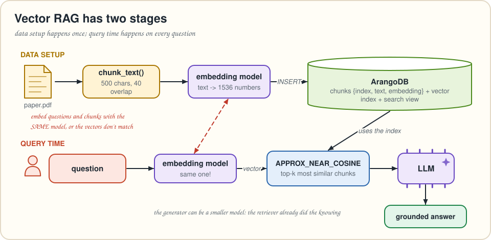
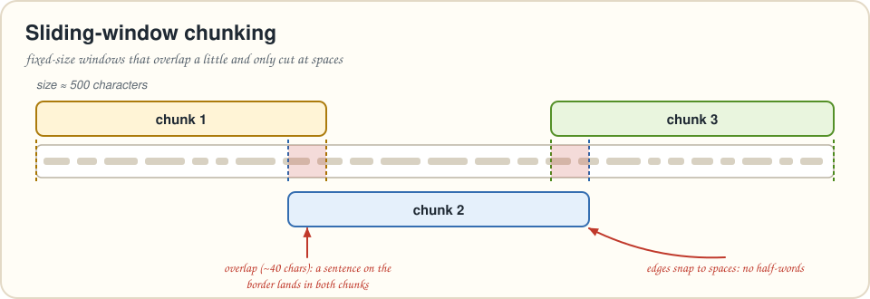
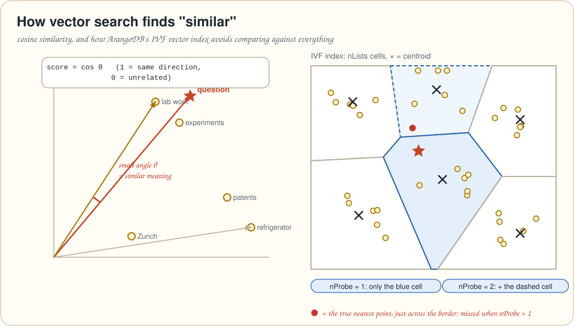
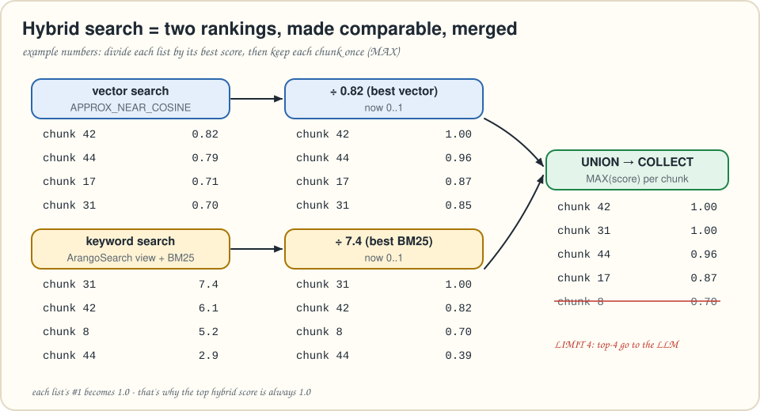

# Chapter 2 · Vector similarity search & hybrid search

> *Summarizes* Essential GraphRAG *chapter 2. Neo4j's vector and full-text indexes become an ArangoDB vector index and an ArangoSearch view.*
> **Run it:** `python code/ch02_vector_hybrid.py "At what time was Einstein really interested in experimental works?"`

Knowledge graphs are rarely born perfect. Most start as a pile of **unstructured text**, and structure gets added over time. So the book starts where you probably are: you have documents, you want answers, and you want the LLM to stop making things up. This chapter builds the classic **vector RAG** pipeline and then upgrades it to **hybrid search**.

---

## The two halves of every RAG system

A RAG application has two components:

* the **retriever**, which finds relevant information, and
* the **generator**, an LLM that writes the answer *from* that information.

Because the retriever supplies the facts, the generator doesn't need to know everything. It needs to read well, so a **smaller, cheaper, faster model** is often enough. The model is used for its language skills, not its memory.

The retriever needs four ingredients:

| Ingredient | What it is | The decision you make |
|---|---|---|
| **Text chunking** | Splitting documents into smaller pieces | Size, overlap and strategy (sentences, paragraphs, sections, fixed windows…). There's no universal right answer, so experiment. |
| **Embedding model** | Turns text into a vector (a list of numbers) that captures meaning | Which model, and therefore which *dimension* (1,536 for `text-embedding-3-small`). Use the **same model** for documents and questions. If you change it, re-embed everything. |
| **Similarity function** | Measures how close two vectors are | The book uses **cosine** similarity (the angle between vectors), which works well for text. Euclidean (L2) also measures magnitude. |
| **Vector index** | A data structure that finds similar vectors *without* comparing against all of them | Speed vs. accuracy. Index search is **approximate nearest neighbour (ANN)** search. |



The application runs in **two stages**. *Data setup* (once): corpus → chunks → embeddings → database with a vector index. *Query time* (every question): embed the question with the same model, find the nearest chunks, and hand them to the LLM.

---

## Data setup on ArangoDB

### The corpus

The book uses a short paper, ["Einstein's Patents and Inventions"](https://arxiv.org/abs/1709.00666) (Chaudhuri, 2017). LLMs know Einstein well, so the authors ask *very specific* questions that only the paper answers. That makes the difference between "LLM memory" and "retrieved facts" easy to see.

### Chunking



The book chunks the paper with a **sliding window of 500 characters and a 40-character overlap**, cutting only at spaces. That gives 89 chunks in the book's run. Overlap gives text near a boundary a second chance: a short phrase cut off at the end of one chunk appears whole at the start of the next. Snapping to spaces means the embedding model never sees half-words.

```python
from kit.text import chunk_text
chunks = chunk_text(text, size=500, overlap=40)   # code/kit/text.py
```

### Embeddings

```python
from kit import llm
embeddings = llm.embed(chunks)       # text-embedding-3-small -> 1536 floats per chunk
```

The book uses OpenAI models throughout and suggests `all-MiniLM-L12-v2` (Sentence Transformers, runs on a laptop CPU) as an alternative. Our `kit/llm.py` talks to any **OpenAI-compatible** endpoint, so Ollama, vLLM or a gateway work too. It also has an offline `EMBEDDINGS=hash` mode for testing the plumbing without an API key.

### The data model: one collection

The model is about as simple as it gets: one document per chunk.

```json
{ "_key": "42", "index": 42, "text": "…In his ETH days Einstein was genuinely interested in experimental works…",
  "embedding": [0.0123, -0.0456, "… 1536 numbers …"] }
```

The book's Cypher loops over the chunk list and `MERGE`s one node per index. In AQL the direct translation is `UPSERT` ("find a document matching this; insert it if missing, otherwise update it"):

```aql
FOR i IN 0..LENGTH(@texts) - 1
  UPSERT { index: i }
  INSERT { index: i, text: @texts[i], embedding: @embeddings[i] }
  UPDATE { text: @texts[i], embedding: @embeddings[i] }
  IN chunks
```

ArangoDB has a shortcut: when *you* choose the `_key`, re-inserting the same key can simply replace the old document. No lookup is needed, so no extra index is needed either:

```aql
FOR i IN 0..LENGTH(@texts) - 1
  INSERT { _key: TO_STRING(i), index: i, text: @texts[i], embedding: @embeddings[i] }
  INTO chunks
  OPTIONS { overwriteMode: "replace" }
```

> [!WARNING]
> ⚠️ **Watch Out! AQL ranges count *down* too.** `0..LENGTH(@texts) - 1` is `0..-1` when the list is empty, and that range is `[0, -1]`, not empty. Never send an empty list into an index loop like this. Guard it in Python, or loop over the values (`FOR t IN @texts`) instead of the positions.

### The vector index

> [!NOTE]
> 🔄 **Translation Station.** Neo4j: `CREATE VECTOR INDEX pdf FOR (c:Chunk) ON c.embedding`, then `db.index.vector.queryNodes(...)`.
> ArangoDB: a **vector index** on the `chunks` collection, then the `APPROX_NEAR_COSINE()` function in a normal `FOR … SORT … LIMIT` loop.

```python
chunks.add_index({
    "name": "vec_embedding",
    "type": "vector",
    "fields": ["embedding"],
    "params": {
        "metric": "cosine",      # or "l2", or "innerProduct" (3.12.6+)
        "dimension": 1536,       # must match the embedding model
        "nLists": 9,             # number of cells (centroids) - about sqrt(#docs), never more than #docs
        "defaultNProbe": 8,      # cells searched per query unless the query says otherwise
    },
})                               # code/kit/db.py: ensure_vector_index()
```

Three ArangoDB-specific facts are worth knowing up front:

1. **Turn it on.** Vector indexes need the server started with `--vector-index` (our `docker-compose.yml` does this). Once enabled, you can't switch it off for that deployment.
2. **Data first.** The index is an **IVF** index. It *trains* centroids on the vectors that already exist. Up to v3.12.8 you must insert the data *before* creating the index. From v3.12.9 you can create it first, and it trains once enough documents arrive. Loading first is still recommended.
3. **Dimension and metric are fixed.** Change the embedding model and you rebuild the index, just as the book warns for Neo4j.

From v3.12.10 you can leave `nLists` out, and ArangoDB picks `max(2, 4·√N)` cells per shard. Our helper sets about √N explicitly, which keeps recall high on tiny demo collections like this one.



---

## Query time: vector search

```aql
FOR c IN chunks
  LET score = APPROX_NEAR_COSINE(c.embedding, @question_embedding)
  SORT score DESC
  LIMIT @k
  RETURN { text: c.text, index: c.index, score }
```

Read it line by line:

* `FOR c IN chunks` loops over the chunk documents…
* `LET score = APPROX_NEAR_COSINE(…)` …but because there's a matching vector index, the optimizer turns this into an **index lookup** instead of a full scan…
* `SORT score DESC` + `LIMIT @k` keeps the k most similar (cosine: higher is closer; with `APPROX_NEAR_L2` you sort ascending)…
* `RETURN {…}` builds the result rows.

```python
question = "At what time was Einstein really interested in experimental works?"
hits = kdb.aql(db, VECTOR_SEARCH, question_embedding=llm.embed([question])[0], k=2)
```

In the book's run, the top chunk is the one about Einstein's **ETH days**, when he "worked in the physical laboratory". That's the answer.

> [!IMPORTANT]
> 🧠 **Brain Bender.** You asked for `LIMIT 10` and got 7 rows back. How? *Hint: look at the right half of the figure above.* (Answer: the IVF index only searches the `nProbe` nearest cells. If those cells hold fewer than 10 vectors, you get fewer. Raise `nProbe` per query with `APPROX_NEAR_COSINE(c.embedding, @q, { nProbe: 20 })`.)

From v3.12.6 you may put **one `FILTER`** between `FOR` and `SORT`, and it's applied *during* the index lookup. That's handy for "similar chunks *from this document* only". Attributes listed in the index's `storedValues` can be filtered without loading documents.

## Generating the answer

The generator prompt has a **system message** that sets the role and the rules ("you are an Einstein expert, answer only from the provided documents"), and a **user message** with the retrieved chunks followed by the question:

```python
user_message = ("Use the following documents to answer the question that follows.\n"
                + "\n---\n".join(documents)
                + f"\n\n---\nQuestion (answer only from the documents above): {question}")
```

The LLM answers: *"During his ETH days."* The retriever did the knowing; the model did the reading.

---

## Upgrade: hybrid search

Pure vector search is a big step up from keyword search, but it has blind spots. Embeddings can blur **exact terms**: names, codes, rare words and numbers. Keyword search is great at exactly those. **Hybrid search** runs both and merges the results.

### The keyword side: an ArangoSearch view

> [!NOTE]
> 🔄 **Translation Station.** Neo4j: `CREATE FULLTEXT INDEX … ON EACH [c.text]` and `db.index.fulltext.queryNodes(...)`.
> ArangoDB: an **ArangoSearch view** that indexes `chunks.text` with the built-in `text_en` analyzer (tokenize, lowercase, remove accents, stem), ranked with **BM25**.

```python
db.create_arangosearch_view("chunks_view", properties={
    "links": {"chunks": {"fields": {"text": {"analyzers": ["text_en"]}}}}
})
```

```aql
FOR c IN chunks_view
  SEARCH ANALYZER(c.text IN TOKENS(@question, "text_en"), "text_en")
  LET score = BM25(c)
  SORT score DESC
  LIMIT @k
  RETURN { text: c.text, index: c.index, score }
```

`TOKENS(@question, "text_en")` turns the question into the same normalized tokens that were indexed. `c.text IN [...]` matches documents containing *any* of them, and `BM25(c)` scores how well each document matches. Rare terms count more and long documents count less.

### Merging two rankings

Cosine scores sit between −1 and 1. BM25 scores are unbounded. You can't compare them directly, so the book **normalizes each list by its own best score** and merges.



```aql
LET vector_hits = (
  FOR c IN chunks
    LET score = APPROX_NEAR_COSINE(c.embedding, @question_embedding)
    SORT score DESC
    LIMIT @k
    RETURN { doc: KEEP(c, "_key", "text", "index"), score }
)
LET keyword_hits = (
  FOR c IN chunks_view
    SEARCH ANALYZER(c.text IN TOKENS(@question, "text_en"), "text_en")
    LET score = BM25(c)
    SORT score DESC
    LIMIT @k
    RETURN { doc: KEEP(c, "_key", "text", "index"), score }
)
LET vector_max = MAX(vector_hits[*].score)
LET keyword_max = MAX(keyword_hits[*].score)
FOR hit IN UNION(
    (FOR h IN vector_hits RETURN { doc: h.doc, score: h.score / vector_max }),
    (FOR h IN keyword_hits RETURN { doc: h.doc, score: h.score / keyword_max })
  )
  COLLECT key = hit.doc._key, text = hit.doc.text, index = hit.doc.index
    AGGREGATE score = MAX(hit.score)
  SORT score DESC
  LIMIT @k
  RETURN { text, index, score }
```

New AQL in there:

* `LET x = ( FOR … RETURN … )` is a **subquery**. Its result is an array.
* `vector_hits[*].score` is the **array expansion** operator: "the `score` of every element".
* `KEEP(c, …)` copies only the listed attributes, so we don't drag 1,536-number vectors around.
* `COLLECT … AGGREGATE score = MAX(hit.score)` **groups** by chunk and keeps the best score. That's the de-duplication the book does with `max(score)` in Cypher.

In the book's run, the top result scores exactly **1.0**. It was #1 in its own list, and normalization makes every #1 equal to 1.0. The second result differs from pure vector search, because the keyword side found a better match.

### Bonus: Reciprocal Rank Fusion

Max-normalization is sensitive to outliers. One huge BM25 score squashes all the others. A popular alternative, **Reciprocal Rank Fusion (RRF)**, ignores raw scores and only uses *ranks*: `score = Σ 1 / (60 + rank)`. A chunk ranked well in *both* lists wins. It's in `code/ch02_vector_hybrid.py` as `HYBRID_SEARCH_RRF`; compare the two on your own data.

> [!WARNING]
> ⚠️ **Watch Out! Views are eventually consistent.** An ArangoSearch view refreshes about once per second, so a document inserted a moment ago may not be searchable yet. In tests, add `OPTIONS { waitForSync: true }` after `SEARCH`, which `selftest.py` does. In production, the small delay rarely matters.

---

## 🎙️ Tonight's Talk: Vector search vs. Keyword search

> **Vector:** I understand *meaning*. Ask about "experimental work" and I'll find "worked in the physical laboratory".
>
> **Keyword:** Ask for "invoice INV-2024-0042" and watch you return something "about invoices in general".
>
> **Vector:** Fine. Exact identifiers aren't my thing.
>
> **Keyword:** And you need a model for every query. I need an inverted index and some arithmetic.
>
> **Vector:** You'd return nothing for "fridge" when the text says "refrigerator".
>
> **Both:** …so we work as a team. That's hybrid search.

## 🙋 No Such Thing as a Dumb Question

**Q: My model has a 200k-token context window. Why chunk at all?**
A: Smaller chunks give *sharper* embeddings and cheaper, more focused prompts. A whole paper squeezed into one vector is the average of many topics. Chapter 3 shows how to get both: precise matching *and* big context.

**Q: Do I need a vector index for a few hundred chunks?**
A: No. `COSINE_SIMILARITY(c.embedding, @q)` computes exact similarity for every document. That's fine for small collections and for re-ranking a handful of candidates (chapter 6 does this). The index pays off at scale.

**Q: Cosine, L2 or inner product?**
A: Use whatever your embedding model was trained for. For normalized text embeddings, cosine and inner product rank identically, and `innerProduct` (3.12.6+) skips the normalization step, so it's faster.

**Q: Why does `text_en` find "inventions" when I search "invention"?**
A: The analyzer **stems** words to their root at index time *and* at query time (that's why we wrap the question in `TOKENS(…, "text_en")`).

## 📌 Key Takeaways

* A RAG system = **retriever** + **generator**. Good retrieval lets you use a smaller generator.
* The retriever needs a **chunking strategy**, an **embedding model** (the same for documents and questions), a **similarity function** and usually a **vector index** (approximate).
* In ArangoDB, start the server with `--vector-index`, load data, create a `vector` index, and query with `SORT APPROX_NEAR_COSINE(…) DESC LIMIT k`. `nLists` and `nProbe` trade speed for recall.
* **Hybrid search** adds BM25 keyword search through an **ArangoSearch view**, normalizes both rankings, merges them, and keeps each chunk once.
* Even hybrid search over raw chunks has limits: references between chunks get lost, and a chunk often lacks the context around it. That's chapter 3's starting point.

## ✏️ Pencil Time

**1 · Be the optimizer.** Vector scores: A 0.90, B 0.85, C 0.60. BM25 scores: C 12.0, D 9.0, A 3.0. With `k = 3`, what does `HYBRID_SEARCH` return, in order?

**2 · Exact search, no index.** Write an AQL query that returns the 3 chunks most similar to `@q` *without* using the vector index.

**3 · Query magnets.** Put these lines in a working order:
`LIMIT @k` · `RETURN c.text` · `FOR c IN chunks` · `SORT APPROX_NEAR_COSINE(c.embedding, @q) DESC`

<details>
<summary>▸ Solutions</summary>

**1.** Normalized vector: A 1.00, B 0.94, C 0.67. Normalized BM25: C 1.00, D 0.75, A 0.25. MAX per chunk: A 1.00, C 1.00, B 0.94, D 0.75. Top 3 → **A, C, B** (A and C tie at 1.0; their relative order isn't guaranteed).

**2.**
```aql
FOR c IN chunks
  LET score = COSINE_SIMILARITY(c.embedding, @q)
  SORT score DESC
  LIMIT 3
  RETURN { text: c.text, score }
```

**3.** `FOR c IN chunks` → `SORT APPROX_NEAR_COSINE(c.embedding, @q) DESC` → `LIMIT @k` → `RETURN c.text`. The vector index is only used when `SORT` on the approximate function is followed by `LIMIT`.

</details>

---
[← Chapter 1](01-improving-llm-accuracy.md) · [Contents](../README.md) · [Chapter 3 →](03-advanced-vector-retrieval.md)
