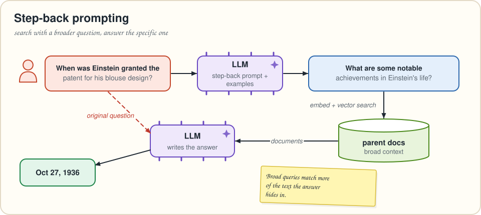
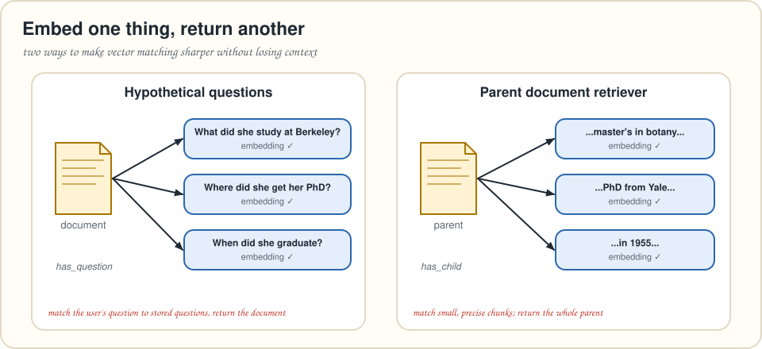
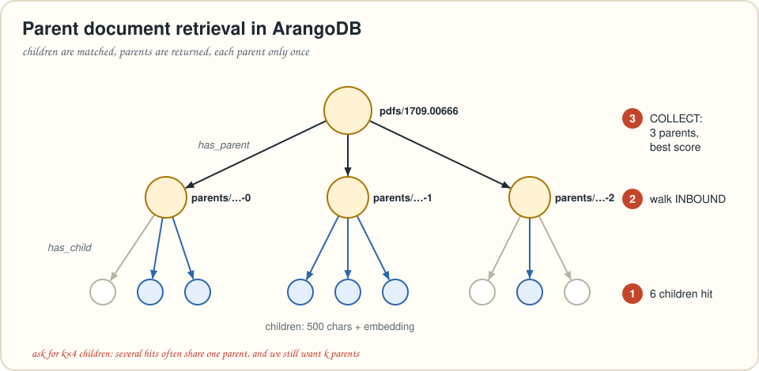

# Chapter 3 · Smarter vector retrieval

> *Summarizes* Essential GraphRAG *chapter 3, "Advanced vector retrieval strategies." The parent/child document graph is rebuilt with ArangoDB collections, edges and one traversal.*
> **Run it:** `python code/ch03_advanced_vector.py "When was Einstein granted the patent for his blouse design?"`

You shipped chapter 2's RAG app. Users like it… mostly. Some answers are thin, some miss the point, and when you look at what the retriever handed the LLM, the problem is obvious: **the right text never made it into the prompt.**

The book pins this on a **mismatch**: the embedding of the user's *question* doesn't always sit close to the embedding of the *document* that holds the answer. They use different words, focus on different details, or one is tiny and the other is huge. This chapter attacks the mismatch from both ends.

---

## Two ways to close the gap

| Fix the **question** (query rewriting) | Fix the **documents** (embedding strategy) |
|---|---|
| Rephrase the question so it looks more like the text that answers it. | Embed something *other than* what you return, chosen to match questions better. |
| **HyDE**: let the LLM write a *hypothetical answer* and search with that. | **Hypothetical questions**: embed questions each document can answer. |
| **Step-back prompting**: make the question *more general*. | **Parent document retriever**: embed small chunks, return their big parent. |

The book implements one from each column: **step-back prompting + parent document retrieval**.

> [!TIP]
> 😌 **Relax: there are more knobs.** The book also mentions, without implementing them: **finetuning the embedding model** (then you re-embed everything), **reranking** (a second, smarter pass over the top results), **metadata filtering** (narrow by date, author or type *before* comparing vectors) and **hybrid retrieval** (chapter 2). In ArangoDB, metadata filtering is a `FILTER` inside the vector query (3.12.6+), and reranking can be an exact `COSINE_SIMILARITY()` or a cross-encoder over the top 50 candidates.

---

## Step-back prompting



Step-back prompting (Zheng et al., 2023) turns a narrow question into a broader one. "Which team did Thierry Audel play for from 2007 to 2008?" becomes "Which teams did Thierry Audel play for in his career?" The broad version matches a wider range of text, and the specific answer usually sits somewhere inside it.

It's an LLM task, so it's just a prompt. A bare instruction is **zero-shot**. Adding a few input→output examples makes it **few-shot**, which anchors the style and makes outputs more consistent (two to five examples is typical):

```python
STEPBACK_SYSTEM = """You rewrite questions for a search engine.
Step back from the specifics and paraphrase the question into a more generic
question whose answer would contain the original answer. Reply with the
rewritten question only.

Examples
input:  Which company did Satya Nadella work for in 1995?
output: What is Satya Nadella's employment history?
input:  Did Marie Curie win a Nobel Prize in 1911?
output: Which awards did Marie Curie receive during her career?"""

def stepback(question: str) -> str:
    return llm.chat([{"role": "system", "content": STEPBACK_SYSTEM},
                     {"role": "user", "content": question}]).strip()
```

> [!WARNING]
> ⚠️ **Watch Out! Search with the broad question, answer the *original* one.** The step-back question is only for *retrieval*. If you also give it to the generator, you'll get a lovely essay about Einstein's career instead of the date the user asked for.

---

## The parent document retriever

### Why small chunks *and* big chunks?

Embed a long document and its vector is the *average* of many ideas, so it matches nothing sharply. Embed a tiny chunk and it matches sharply, but it's too little context for the LLM to answer well. The parent document retriever does both: **match on small children, return the big parent.**



### The graph

The book stores the structure as a graph, and so do we:

```text
pdfs  --has_parent-->  parents (<= 2,000 chars)  --has_child-->  children (500 chars + embedding)
```

```python
kdb.ensure_graph(db, "einstein", [
    {"edge_collection": "has_parent", "from_vertex_collections": ["pdfs"],    "to_vertex_collections": ["parents"]},
    {"edge_collection": "has_child",  "from_vertex_collections": ["parents"], "to_vertex_collections": ["children"]},
])
```

### Splitting: structure first, then size

Good chunking follows the document's **own structure** first. The paper's sections are numbered ("1.", "3A.", …), so a regular expression splits on those headings. That gives nine sections: four main ones, four subsections (3A–3D) about specific patents, and the introduction. Then **count tokens** (the book uses `tiktoken`): the sections range from about 150 tokens to one monster of over **4,000**. That's too big to hand around, so each section is split into **parents of at most 2,000 characters**, and each parent into **children of 500 characters**.

> [!IMPORTANT]
> 🧠 **Brain Bender.** Some sections are tiny, say 20 tokens. Should they become parents? *(The book's Exercise 3.2 suggests dropping segments that are too short to carry information, and splitting ones that are too long.)*

### Importing a parent and its children: one AQL query

> [!NOTE]
> 🔄 **Translation Station.** The book's Cypher `MERGE`s the PDF, `MERGE`s the parent, links them, then `UNWIND`s the children and `MERGE`s each one with its embedding. In AQL every write is an explicit `INSERT` / `UPSERT` into a named collection, and edges are documents with `_from` / `_to`.

```aql
LET pdf = FIRST(
  UPSERT { _key: @pdf_id }
  INSERT { _key: @pdf_id, title: @title }
  UPDATE {}
  IN pdfs
  RETURN NEW
)
LET parent = FIRST(
  INSERT { _key: @parent_key, text: @parent_text }
  INTO parents OPTIONS { overwriteMode: "replace" }
  RETURN NEW
)
LET pdf_link = (
  INSERT { _key: @parent_key, _from: pdf._id, _to: parent._id }
  INTO has_parent OPTIONS { overwriteMode: "ignore" }
)
LET kids = (
  FOR i IN 0..LENGTH(@children) - 1
    INSERT { _key: CONCAT(@parent_key, "-", i), text: @children[i], embedding: @embeddings[i] }
    INTO children OPTIONS { overwriteMode: "replace" }
    RETURN NEW._id
)
FOR kid IN kids
  INSERT { _key: PARSE_IDENTIFIER(kid).key, _from: parent._id, _to: kid }
  INTO has_child OPTIONS { overwriteMode: "ignore" }
```

What's going on:

* `UPSERT … RETURN NEW` wrapped in `FIRST(...)` creates the PDF document if it's missing and hands it back as a variable.
* Keys are **deterministic** (`1709.00666-3`, `1709.00666-3-2`), and `overwriteMode` makes re-runs idempotent: `"replace"` refreshes documents, `"ignore"` skips edges that already exist.
* `PARSE_IDENTIFIER("children/1709.00666-3-2").key` → `"1709.00666-3-2"`. The edge reuses the child's key.
* AQL rule of thumb: **each collection may be written once per query, and not read after it's written.** We write `pdfs`, `parents`, `has_parent`, `children` and `has_child`, each exactly once.

Then a vector index goes on `children.embedding`, after the data is in, as in chapter 2.

### Retrieval: match children, return parents



```aql
WITH parents
LET hits = (
  FOR child IN children
    LET score = APPROX_NEAR_COSINE(child.embedding, @question_embedding)
    SORT score DESC
    LIMIT @candidates
    RETURN { id: child._id, score }
)
FOR hit IN hits
  FOR parent IN 1..1 INBOUND hit.id has_child
    COLLECT key = parent._key, text = parent.text AGGREGATE score = MAX(hit.score)
    SORT score DESC
    LIMIT @k
    RETURN { key, text, score }
```

1. The subquery fetches **`@candidates = k × 4`** nearest children. Why ×4? Several top children often belong to the *same* parent. Over-fetching leaves enough distinct parents after de-duplication.
2. `FOR parent IN 1..1 INBOUND hit.id has_child` walks **up** one edge, against the arrow, from each child to its parent.
3. `COLLECT … AGGREGATE score = MAX(hit.score)` keeps **each parent once**, scored by its best child.
4. `LIMIT @k` enforces the final count.

`WITH parents` declares the collection the traversal lands in. It's optional on a single server and **required in a cluster**.

### The whole pipeline

```python
def rag_pipeline(db, question: str) -> str:
    broader = stepback(question)                     # 1. rewrite for retrieval
    documents = parent_retrieval(db, broader)        # 2. children -> parents
    return generate_answer(question, documents)      # 3. answer the ORIGINAL question
```

In the book's run, *"When was Einstein granted the patent for his blouse design?"* steps back to *"What are some notable achievements in Einstein's life?"* The parents retrieved for that broad question contain the answer: **October 27, 1936**.

### Bonus: the hypothetical-question strategy in AQL

The book describes this strategy but doesn't implement it. It's the same graph shape, with questions instead of children. An LLM writes three questions per parent, and those get embedded and linked with `has_question`. Retrieval is the mirror image of the query above:

```aql
WITH parents
LET hits = (
  FOR q IN questions
    LET score = APPROX_NEAR_COSINE(q.embedding, @question_embedding)
    SORT score DESC
    LIMIT @candidates
    RETURN { id: q._id, score }
)
FOR hit IN hits
  FOR doc IN 1..1 INBOUND hit.id has_question
    COLLECT key = doc._key, text = doc.text AGGREGATE score = MAX(hit.score)
    SORT score DESC
    LIMIT @k
    RETURN { key, text, score }
```

User questions tend to look like *other questions* more than they look like paragraphs, so question-to-question matching is often sharper. Try both on your data (`add_hypothetical_questions()` in the chapter script).

---

## 🎙️ Tonight's Talk: Small chunk vs. Big chunk

> **Small chunk:** I'm precise. When a question is about the refrigerator patent, my embedding *is* the refrigerator patent.
>
> **Big chunk:** And then the LLM gets three sentences and no context. Who invented it with Einstein? When? Why?
>
> **Small chunk:** You're so long your embedding is a smoothie of six topics.
>
> **Big chunk:** Fair. How about you get matched…
>
> **Small chunk:** …and you get returned. Deal. Draw an edge between us.

## 🙋 No Such Thing as a Dumb Question

**Q: Why store parent/child links as a graph instead of a `parent_id` attribute?**
A: An attribute works too (`DOCUMENT("parents", child.parent_key)`). Edges make the structure explicit and queryable in both directions ("all children of X", "the PDF of this child"). It's also where the book is heading: once text lives in a graph, you can link it to entities (chapters 6–7).

**Q: Isn't step-back lossy? The year disappears from the question.**
A: Yes, on purpose, and only for *retrieval*. The generator still sees the original question with the year. If your users search for exact identifiers, combine step-back with the keyword side of hybrid search.

**Q: What's HyDE again?**
A: *Hypothetical Document Embeddings* (Gao et al., 2022): the LLM writes a fake answer, and you embed *that*. Fake answers look like real documents, so they land near them in vector space. It's the same idea as step-back: make the query look like the target.

## 📌 Key Takeaways

* Retrieval often fails because **question embeddings and document embeddings don't line up**.
* **Query rewriting** fixes the question side. **Step-back prompting** broadens it with a few-shot LLM prompt, but you still answer the original question.
* **Embedding strategies** fix the document side: embed **hypothetical questions** or **small children**, and return the **parent**.
* In ArangoDB, the parent/child structure is two edge collections. Retrieval is one query: **vector search → INBOUND traversal → COLLECT with MAX → LIMIT**.
* Over-fetch candidates (**k × 4**) so de-duplication still leaves k results.

## ✏️ Pencil Time

**1 · Step back.** Write step-back versions of: (a) "What did ArangoDB 3.12.4 add for vectors?" (b) "Was Leo Szilard at the 1927 patent filing?"

**2 · Evidence, please.** Modify `PARENT_RETRIEVAL` so each returned parent also lists the text of the children that matched. That's handy for highlighting *why* a parent was chosen.

**3 · Count the cost.** With `k = 4` and the ×4 rule, how many children does the vector index return? If they all belong to 2 parents, how many documents reach the LLM?

<details>
<summary>▸ Solutions</summary>

**1.** (a) "What did ArangoDB 3.12.4 add?", or more generally "What vector search features does ArangoDB have?" (b) "What was Leo Szilard's collaboration with Einstein?"

**2.** Group with `INTO` to keep the matching hits:
```aql
WITH parents
LET hits = (
  FOR child IN children
    LET score = APPROX_NEAR_COSINE(child.embedding, @question_embedding)
    SORT score DESC
    LIMIT @candidates
    RETURN { id: child._id, text: child.text, score }
)
FOR hit IN hits
  FOR parent IN 1..1 INBOUND hit.id has_child
    COLLECT key = parent._key, text = parent.text INTO matched = hit
    LET score = MAX(matched[*].score)
    SORT score DESC
    LIMIT @k
    RETURN { key, text, score, evidence: matched[*].text }
```

**3.** 16 children; only 2 parents reach the LLM. That's the reason to over-fetch. If even ×4 isn't enough for your data, raise the multiplier.

</details>

---
[← Chapter 2](02-vector-and-hybrid-search.md) · [Contents](../README.md) · [Chapter 4 →](04-text2aql.md)
