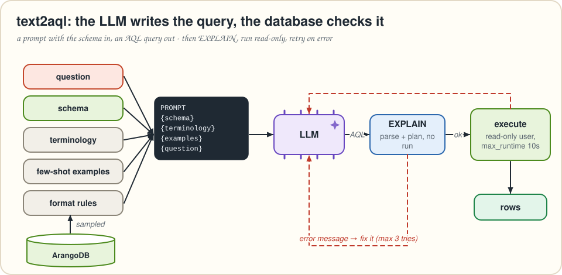
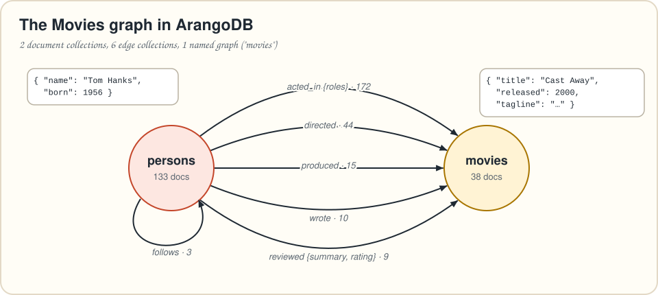
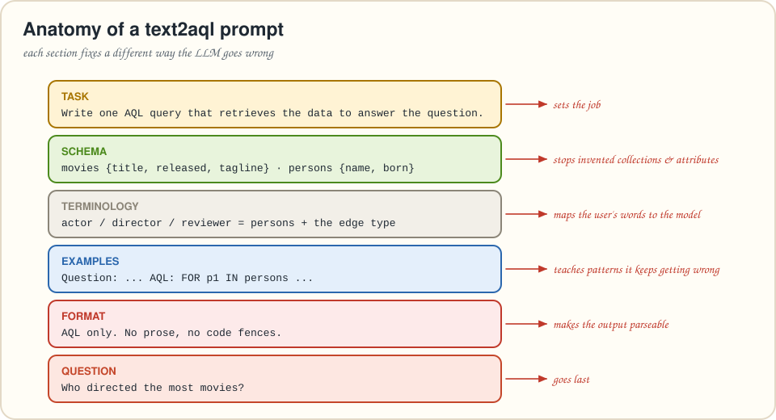

# Chapter 4 · text2aql: let the LLM write the query

> *Summarizes* Essential GraphRAG *chapter 4, "Generating Cypher queries from natural language questions." Here the LLM writes **AQL** for ArangoDB.*
> **Run it:** `python code/load_movies.py` (once), then `python code/ch04_text2aql.py "Who directed the most movies?"`

Try this question on chapter 3's retriever:

> *"List the top three highest-rated movies directed by Steven Spielberg, with their average score."*

No amount of vector similarity will answer it. The question isn't asking for *text that resembles it*. It's asking the database to **filter** (Spielberg), **traverse** (directed, reviewed), **aggregate** (average) and **sort** (top three). That takes a *query*. So let the LLM write one.

---

## Where text2aql fits

Most LLMs have seen plenty of query languages and know the basics of the syntax. Getting a query that is **correct and relevant** is the hard part. That depends on two things:

* the **semantics** of the question (what is actually being asked), and
* the **schema** of your graph (which collections, edges and attributes exist).

Without a schema, the model *guesses* names, and it guesses wrong in creative ways. The schema in the prompt is the map between the user's words and your data model.

Text-to-query fills two roles in a RAG system:

1. **Questions vectors can't answer**: aggregations, counts, rankings and precise lookups.
2. A **catch-all retriever** when no specialized retriever fits (chapter 5 builds the router that decides).



## Our playground: the Movies graph

The book uses Neo4j's classic **Movies** dataset. `code/load_movies.py` downloads Neo4j's public Cypher script, *parses* it and loads the same data into ArangoDB: 133 people, 38 movies and six relationship types.



> [!NOTE]
> 🔄 **Translation Station.** `(:Person)-[:ACTED_IN {roles}]->(:Movie)` becomes a document in the **edge collection** `acted_in` with `_from: "persons/Tom_Hanks"`, `_to: "movies/Cast_Away"`, `roles: [...]`. Each relationship type gets its own edge collection, and that's what makes AQL traversals like `FOR m IN 1..1 OUTBOUND p acted_in` read so naturally. A named graph `movies` ties them together for tools and visualizers.

---

## Four habits of good query generation

LLMs make mistakes with generated queries, especially when questions are complex or ambiguous, or when the schema's names aren't meaningful. The book recommends four habits.



### 1. Few-shot examples

Show the model a few question→query pairs **from your own graph**. They're graph-specific, so you write them by hand, usually *after* you spot a recurring mistake. The book's example: the model keeps treating a movie's country as an attribute, when the country is really a separate node.

```aql
// What the LLM guessed for "In what country was The Matrix produced?"
FOR m IN movies FILTER m.title == "The Matrix" RETURN m.country
```

Add one example that shows the right pattern, and the whole *family* of questions gets fixed:

```aql
// Question: In what country was the movie Ready Player One produced?
FOR m IN movies
  FILTER m.title == "Ready Player One"
  FOR c IN 1..1 OUTBOUND m produced_in
    RETURN c.name
```

(*`produced_in` and `countries` are hypothetical, as in the book. The Movies data has no countries.*)

### 2. The schema in the prompt

The authors found in Neo4j's internal research that **the exact format of the schema matters little**. What matters is that it clearly lists the node types, relationship types, properties and which relationships connect which nodes. Neo4j users infer the schema with APOC's `apoc.meta.data()`, which samples the graph. ArangoDB has no APOC, but two small AQL queries do the same job by **sampling** documents:

```aql
FOR d IN @@collection
  LIMIT @sample
  FOR attribute IN ATTRIBUTES(d, true)
    COLLECT name = attribute AGGREGATE types = UNIQUE(TYPENAME(d[attribute]))
    SORT name
    RETURN { name, types }
```

```aql
FOR e IN @@collection
  LIMIT @sample
  COLLECT from_collection = PARSE_IDENTIFIER(e._from).collection,
          to_collection = PARSE_IDENTIFIER(e._to).collection
  RETURN { from_collection, to_collection }
```

* `@@collection` is a **collection bind parameter** (two `@`s). Use it to pass a collection *name*.
* `ATTRIBUTES(d, true)` lists attribute names and drops system ones like `_key`, `_from` and `_to`. `TYPENAME()` gives `"string"`, `"number"`, `"array"`, and so on.
* `PARSE_IDENTIFIER("persons/Tom_Hanks").collection` → `"persons"`. That's how we learn which collections an edge collection connects.

`format_schema()` turns the results into prompt-friendly text:

```text
Document collections and attributes:
movies {released: number, tagline: string, title: string}
persons {born: number, name: string}
Edge collections and attributes:
acted_in {roles: array}
reviewed {rating: number, summary: string}
...
Relationships (edge collection: from -> to):
acted_in: persons -> movies
follows: persons -> persons
...
```

Sampling keeps this cheap on big graphs. For very large schemas, consider exposing only the part relevant to the use case.

### 3. Terminology mapping

Even with a clean schema (nouns for collections, verbs for edges), users say "film", "director" or "reviewer". Tell the model what those mean *in your graph*:

```text
Persons: actors, directors, writers, producers and reviewers are all documents in the
`persons` collection; their job is the edge collection that connects them to a movie.
Movies: a "film" or "movie" is a document in the `movies` collection.
```

These mappings are graph-specific, hard to reuse, and **grow over time** as you discover misunderstandings.

### 4. Format instructions

Some models wrap queries in code fences, others add a friendly explanation, others apologize. You need *just the query*, so say so: "Respond with the AQL query only, no explanations, no code fences." Our code also strips stray fences, just in case.

---

## The prompt, assembled

```text
Task: write one AQL (ArangoDB Query Language) query that retrieves the data needed to answer the user question.

Database schema:
Use only the collections, edge collections and attributes listed here. Do not invent others.
{schema}

Terminology mapping:
{terminology}

Examples:
{examples}

AQL reminders:
- Walk relationships with: FOR v, e IN 1..1 OUTBOUND|INBOUND|ANY start edge_collection
- Return only the attributes you need, never whole documents.
- The query must be read-only: no INSERT, UPDATE, REPLACE, REMOVE or UPSERT.

Format instructions:
Respond with the AQL query only - no code fences, no comments.

User question: {question}
```

The "AQL reminders" block isn't in the book. It's there because general-purpose models have seen far more Cypher and SQL than AQL, and a two-line syntax hint noticeably reduces mistakes. One of our few-shot examples:

```aql
FOR p1 IN persons
  FOR m IN 1..1 OUTBOUND p1 acted_in
    FOR p2 IN 1..1 INBOUND m acted_in
      FILTER p1._key < p2._key
      COLLECT actor1 = p1.name, actor2 = p2.name WITH COUNT INTO movie_count
      SORT movie_count DESC
      LIMIT 1
      RETURN { actor1, actor2, movie_count }
```

Read it as a nested loop: for every person, for each movie they acted in, for every co-actor in that movie. `FILTER p1._key < p2._key` keeps each pair once (the book's Cypher uses `p1 <> p2`, which counts every pair twice). `COLLECT … WITH COUNT INTO` groups and counts.

For *"Who directed the most movies?"* a model typically returns:

```aql
FOR p IN persons
  LET movie_count = LENGTH(FOR m IN 1..1 OUTBOUND p directed RETURN 1)
  SORT movie_count DESC
  LIMIT 1
  RETURN { name: p.name, movie_count }
```

> [!WARNING]
> ⚠️ **Watch Out! `LIMIT 1` hides ties.** In this dataset Lana *and* Lilly Wachowski directed 5 movies each. The query above silently picks one. If ties matter, compute the maximum first:
> ```aql
> LET counts = (
>   FOR e IN directed
>     COLLECT director = e._from WITH COUNT INTO movie_count
>     RETURN { director, movie_count }
> )
> LET top = MAX(counts[*].movie_count)
> FOR c IN counts
>   FILTER c.movie_count == top
>   RETURN { name: DOCUMENT(c.director).name, movie_count: c.movie_count }
> ```

> [!CAUTION]
> ⚠️ **Watch Out! `null` sorts *below* every number in AQL.** "List people born before 1940" → `FILTER p.born < 1940` returns **15** people on this dataset, including 5 people with *no* birth year. In Cypher, `null < 1940` is `null`, so those rows are dropped. In AQL, `null < 1940` is `true`. Write `FILTER p.born != null AND p.born < 1940` (10 people). `selftest.py` checks this exact trap. Teach it to your LLM with a few-shot example.

---

## Running generated queries *safely*

The book stops at generating the query. Before you put text2aql in front of users, add the guard rails (all in `ch04_text2aql.py`):

| Guard | How | Why |
|---|---|---|
| **Read-only user** | `create_user("aql_reader")` + `update_permission(..., "ro", db)` | The real safety net: even a prompt-injected `REMOVE` fails. |
| **Keyword filter** | reject `INSERT/UPDATE/REPLACE/REMOVE/UPSERT` | Cheap early rejection with a clear error message. |
| **EXPLAIN first** | `db.aql.explain(query)` | Catches syntax errors and unknown collections *without running anything*. |
| **Limits** | `max_runtime=10`, `memory_limit=256 MB` | A Cartesian-product query can't take the server down. |
| **Self-repair** *(bonus)* | send the error back: "That query failed: … Return a corrected AQL query only." (max 3 tries) | Most first-try failures are small, fixable syntax slips. |

```python
query, rows = text2aql(db, "Who directed the most movies?")
```

> [!TIP]
> 😌 **Relax: you don't have to build this yourself.** The `langchain-arangodb` package ships an `ArangoGraphQAChain` that does text-to-AQL with schema generation, AQL examples, `max_aql_generation_attempts` (default 3) and a `force_read_only_query` switch. Building it once by hand, as the book insists, is how you learn which knob to turn when the framework's output is wrong.

## Specialized models

The authors, who worked together at Neo4j, describe Neo4j's open **text2cypher** training data and finetuned open models: faster and cheaper, but behind the largest general models. There's no equivalent public AQL dataset that we know of. The recipe transfers, though: log question→AQL pairs that passed review (chapter 8's benchmark is a start), and you have finetuning data for a small, fast text2aql model.

---

## 🎙️ Tonight's Talk: Cypher vs. AQL

> **Cypher:** I *draw* the pattern: `(p:Person)-[:DIRECTED]->(m:Movie)`. ASCII art! Readers love me.
>
> **AQL:** I *walk* it: `FOR m IN 1..1 OUTBOUND p directed`. Readers who've written a `for` loop understand me in a second.
>
> **Cypher:** Variable-length paths? `-[:KNOWS*1..3]->`. One line.
>
> **AQL:** `FOR v IN 1..3 OUTBOUND p knows`. Also one line. And I do documents, full-text and vectors in the same query.
>
> **Cypher:** LLMs have seen more of me.
>
> **AQL:** True. That's why chapter 4 gives them a schema, examples and a two-line reminder.

## 🙋 No Such Thing as a Dumb Question

**Q: Why sample only 100 documents for the schema?**
A: Speed. On big collections a full scan for every prompt is wasteful. Sampling misses rare attributes, so if one matters, add it to the terminology section by hand or raise the sample size.

**Q: Should I use a named graph (`GRAPH "movies"`) or edge collections in queries?**
A: Either works. Listing edge collections (`OUTBOUND p acted_in`) is explicit and lets the LLM choose relationship types precisely, the way Cypher relationship types do.

**Q: Isn't letting an LLM write queries dangerous?**
A: It's exactly as dangerous as the permissions you give it. A read-only user plus a runtime limit turns "dangerous" into "occasionally wrong", and chapter 8 is about catching "wrong".

## 📌 Key Takeaways

* text2aql answers what vectors can't: **filter, traverse, aggregate, rank**. It also works as a catch-all retriever.
* Put the **schema** in the prompt. In ArangoDB, infer it by **sampling** with `ATTRIBUTES`, `TYPENAME` and `PARSE_IDENTIFIER`.
* Add **few-shot examples** for mistakes you've seen, a **terminology mapping** for your users' words, and **format instructions** for parseable output.
* AQL quirks worth a few-shot example: **`null` sorts lowest** (guard `<` comparisons), and `LIMIT 1` hides ties.
* Run generated AQL as a **read-only user**, `EXPLAIN` it first, cap runtime and memory, and let the LLM **repair** failed queries.

## ✏️ Pencil Time

Write AQL for:

1. The book's opening question: the top three movies directed by `"Steven Spielberg"` by average review rating.
2. Actors born after 1970 who acted alongside Tom Hanks.
3. Movies with more than 5 actors, biggest casts first.

<details>
<summary>▸ Solutions</summary>

**1.** (Returns nothing on this dataset, since Spielberg isn't in it. Try `"Ron Howard"`.)
```aql
FOR director IN persons
  FILTER director.name == "Steven Spielberg"
  FOR movie IN 1..1 OUTBOUND director directed
    LET avg_rating = AVERAGE(
      FOR reviewer, review IN 1..1 INBOUND movie reviewed
        RETURN review.rating
    )
    SORT avg_rating DESC
    LIMIT 3
    RETURN { title: movie.title, avg_rating }
```
`FOR reviewer, review IN …`: the second traversal variable is the **edge**, where the rating lives.

**2.**
```aql
FOR hanks IN persons
  FILTER hanks.name == "Tom Hanks"
  FOR movie IN 1..1 OUTBOUND hanks acted_in
    FOR costar IN 1..1 INBOUND movie acted_in
      FILTER costar._id != hanks._id AND costar.born > 1970
      RETURN DISTINCT costar.name
```
Here `null` is harmless: `null > 1970` is `false`. It's only `<` comparisons that bite.

**3.**
```aql
FOR movie IN movies
  LET actors = LENGTH(FOR p IN 1..1 INBOUND movie acted_in RETURN 1)
  FILTER actors > 5
  SORT actors DESC
  RETURN { title: movie.title, actors }
```

</details>

---
[← Chapter 3](03-advanced-vector-retrieval.md) · [Contents](../README.md) · [Chapter 5 →](05-agentic-rag.md)
