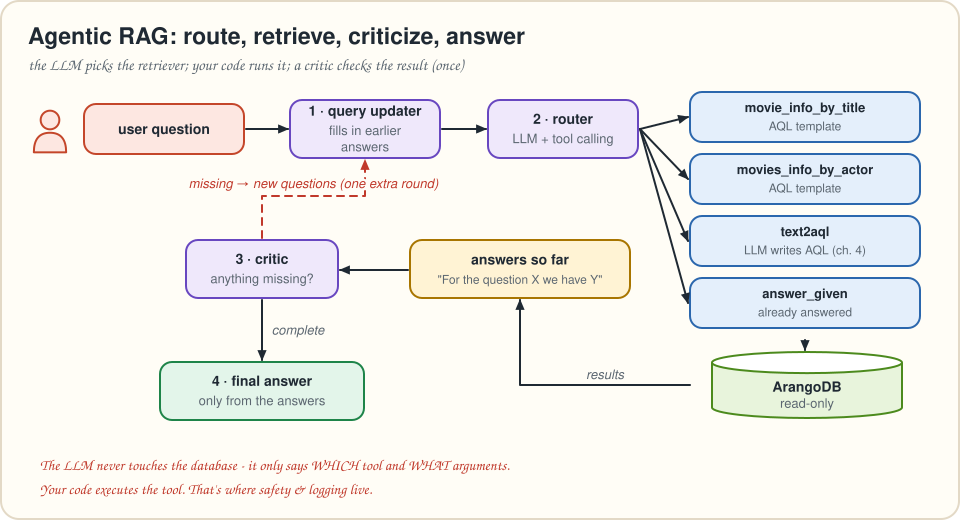
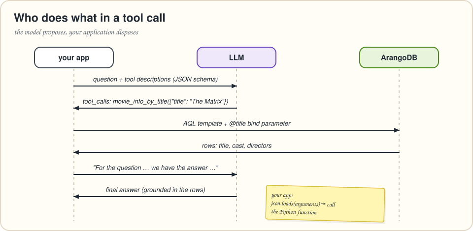
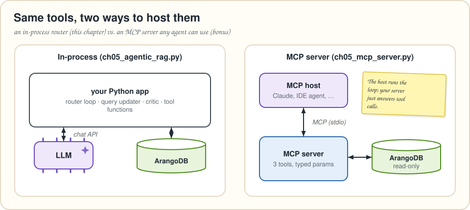

# Chapter 5 · Agentic RAG: a router, some tools and a critic

> *Summarizes* Essential GraphRAG *chapter 5, "Agentic RAG." Every retriever tool runs AQL. Bonus: the same tools as an MCP server.*
> **Run it:** `python code/load_movies.py` (once), then `python code/ch05_agentic_rag.py "Who directed The Matrix, and which other movies did they direct?"`

By now you own several retrievers: vector search, hybrid search, parent documents and text2aql. Each is great at *some* questions. Users don't label their questions, though. "What's *The Matrix* about?", "How many movies did Tom Hanks make?" and "Is the guy who directed *Apollo 13* also an actor?" all arrive in the same chat box.

**Agentic RAG** lets an LLM pick the right retriever for each question, run it, check whether the answer is complete, and go back for more if needed.

---

## What makes RAG "agentic"?

An agentic system *acts on the user's behalf*. Agents range from simple to very sophisticated (planners that break a task into many steps). The book deliberately builds the **simple, robust** kind, which is often all RAG needs. It has three parts:

| Part | Job |
|---|---|
| **Retriever router** | Reads the question and picks the best retriever(s), *with arguments*. Usually an LLM. |
| **Retriever agents** (tools) | The retrievers themselves, from **generic** (vector search, text2aql) to **specialized** (a fixed, parameterized query). |
| **Answer critic** | Checks whether the collected answers actually answer the question. If not, it asks follow-up questions, with an **exit criterion** so the loop can't spin forever. |



## Why bother?

1. **Many data sources.** Use the best source for each question.
2. **Complex data.** Generic text2aql struggles as schemas grow. Narrow, **specialized retrievers** (often a hard-coded AQL template with parameters) are reliable for the questions they cover.

Over time you watch which questions the generic tools get wrong, write specialized tools for those, and keep text2aql as the **catch-all**. The router keeps quality consistent as the toolbox grows.

---

## The tools

The LLM picks tools by reading their **descriptions**, so write them as carefully as code. The book uses OpenAI's tool (function-calling) format. Models without native tool calling can do the same with the ReAct prompting pattern.

### Two specialized tools: AQL templates

```aql
WITH persons
FOR m IN movies
  FILTER CONTAINS(LOWER(m.title), LOWER(@title))
  LET cast = (FOR p IN 1..1 INBOUND m acted_in RETURN p.name)
  LET directors = (FOR p IN 1..1 INBOUND m directed RETURN p.name)
  RETURN { title: m.title, released: m.released, tagline: m.tagline, cast, directors }
```

```aql
WITH movies
FOR p IN persons
  FILTER CONTAINS(LOWER(p.name), LOWER(@actor))
  FOR m IN 1..1 OUTBOUND p acted_in
    LET cast = (FOR c IN 1..1 INBOUND m acted_in RETURN c.name)
    LET directors = (FOR d IN 1..1 INBOUND m directed RETURN d.name)
    RETURN { actor: p.name, title: m.title, released: m.released, cast, directors }
```

* `CONTAINS(LOWER(x), LOWER(@y))` gives forgiving, case-insensitive matching. "matrix" finds all three Matrix films.
* Each `LET … = (FOR … RETURN …)` subquery collects a list. That's the AQL version of Cypher's `OPTIONAL MATCH … collect(...)`. A movie with no directors gets `[]`, not a missing row.
* The `@title` / `@actor` **bind parameters** are the tool's arguments. The LLM fills them in, and they can never change the *shape* of the query, which is a big safety win over text2aql.

> [!NOTE]
> 🔄 **Translation Station.** The book's Cypher for the actor tool places its `WHERE` clause after the `OPTIONAL MATCH`es, so it filters the wrong thing. The AQL version above filters the actor *first*, then walks to the movies. [Appendix C](appendix-c-translation-notes.md) lists this and the other spots we fixed while translating.

### The catch-all: text2aql

Chapter 4's `text2aql()` becomes a tool whose description says *"Use this when no other tool fits (counts, rankings, filters, …)"*.

### The surprisingly useful tool: `answer_given`

The book's authors almost always add a tool for **"the answer is already in the conversation"**. Asked "What's Dave Smith's last name?", the right move is to *extract* "Smith", not to query the database.

```python
def _tool(name, description, param, param_description):
    return {"type": "function", "function": {
        "name": name, "description": description,
        "parameters": {"type": "object",
                       "properties": {param: {"type": "string", "description": param_description}},
                       "required": [param]}}}

TOOLS = {
    "movie_info_by_title":  {"description": _tool("movie_info_by_title", "Get information about a movie by its title.", "title", "The movie title"),
                             "function": movie_info_by_title},
    "movies_info_by_actor": {"description": _tool("movies_info_by_actor", "Get the movies an actor has acted in.", "actor", "The actor's name"),
                             "function": movies_info_by_actor},
    "text2aql":             {"description": _tool("text2aql", "Query the movie database with a natural-language question. Use this when no other tool fits (counts, rankings, filters, ...).", "question", "The question to answer from the database"),
                             "function": text2aql_tool},
    "answer_given":         {"description": _tool("answer_given", "Use when the conversation already contains the complete answer to the question.", "answer", "The answer"),
                             "function": answer_given},
}
```

---

## The router



The LLM **can't call anything**. It only *returns* the name of a tool and a JSON string of arguments, possibly several calls for one question. Executing them is your job:

```python
def handle_tool_calls(tool_calls) -> list:
    results = []
    for call in tool_calls or []:
        fn = TOOLS[call.function.name]["function"]
        args = json.loads(call.function.arguments or "{}")
        results.append({"tool": call.function.name, "args": args, "result": fn(**args)})
    return results
```

The routing prompt is short, because tool calling is built into the model:

```text
Choose the right tool(s) to answer the user's question.
The tools are provided with the request. Pass complete, correct arguments.
```

### Continuous query updating

The book routes questions **one at a time**, on purpose. Each question is easier to route on its own, *and* earlier answers can sharpen later questions. Take *"Who has won the most Oscars, and is that person alive?"*: once the first part is answered, "that person" should become a name. A **query updater** LLM does that rewrite:

```text
You make questions atomic, specific and easy to look up.
Fill in missing details of the user's question using the answers given earlier in
this conversation. Change the question only if needed; never ask for more than the
original question did. Reply in JSON: {"question": "<updated question>"}
```

```python
def handle_user_input(question, answers=None):
    answers = [] if answers is None else answers
    updated = query_update(question, answers)           # 1. sharpen with earlier answers
    results = route_question(updated, answers)          # 2. pick + run tools
    answers.append({"role": "assistant",                # 3. remember what we learned
                    "content": f"For the question '{updated}', we have the answer: {json.dumps(results)}"})
    return answers
```

## The answer critic

LLMs make mistakes when rewriting, updating and routing, so a **critic** checks the result before the user sees it:

```text
You check whether a question has been fully answered by the information in this
conversation. If something is missing, list new questions that would gather the
missing information; each must be complete, atomic and specific.
If nothing is missing, return an empty list. Reply in JSON: {"questions": [...]}
```

```python
def get_answer(question):
    answers = handle_user_input(question)
    missing = critique_answers(question, answers)
    if missing:                                    # exit criterion: one extra round, max
        answers = handle_user_input(" ".join(missing), answers)
    final = llm.chat([{"role": "system", "content": MAIN_PROMPT}, *answers,
                      {"role": "user", "content": f"The user question to answer: {question}"}])
    return final, answers
```

The final prompt is strict: *answer only from the information in the conversation, say what's missing, never make anything up*. If the data truly isn't there (say, Oscar counts in a dataset without awards), the right answer is "that information is missing", not a guess.

> [!IMPORTANT]
> 🧠 **Brain Bender.** Why critique only **once**? What could go wrong with "loop until the critic is happy"? *(The data may simply not contain the answer. An unbounded loop burns tokens and time and may never end. One round catches most incomplete answers, and the final prompt can report what's missing.)*

---

## Bonus: the same tools over MCP



The **Model Context Protocol (MCP)** standardizes how agents discover and call tools. Wrap the AQL tools in an MCP server, and any MCP host (a desktop assistant, an IDE agent) becomes your retriever router. `code/ch05_mcp_server.py` does this in a few lines with the MCP Python SDK v2:

```python
from mcp.server.mcpserver import MCPServer    # SDK v2: FastMCP was renamed MCPServer
server = MCPServer("movies-graph")

@server.tool()
def movie_info_by_title(title: str) -> list[dict]:
    """Get information about a movie (release year, tagline, cast, directors) by title."""
    return agent.movie_info_by_title(title)
```

How does this compare to the book's in-process agent?

| | In-process agent (this chapter) | MCP tools |
|---|---|---|
| Who runs the loop | your code: predictable and testable | the host's model: flexible, multi-step |
| Cost & latency | fixed number of LLM calls | depends on how much the agent explores |
| Best for | product features, high-volume Q&A | analyst assistants, exploratory questions |
| Safety | you control everything | expose **narrow, read-only tools** (templates, not raw AQL) |

The two combine well: expose your best retrievers *and* the GraphRAG context builder from chapter 7 as tools, and let the agent dig deeper only when needed.

---

## 🎙️ Tonight's Talk: Specialized tool vs. text2aql

> **Specialized tool:** I answer one kind of question, and I never get it wrong.
>
> **text2aql:** I answer *any* question… most of the time.
>
> **Specialized tool:** You once returned every person born before 1940, plus five people with no birthday at all.
>
> **text2aql:** And you can't count movies per decade.
>
> **Router:** Children, please. Specialized first, text2aql when nothing fits. Every time text2aql stumbles on a pattern twice, we build a new specialized tool.

## 🙋 No Such Thing as a Dumb Question

**Q: The model returned two tool calls for one question. Is that a bug?**
A: No. It's parallel tool calling. "Who directed *The Matrix* and how many movies are there?" can legitimately need two tools. `handle_tool_calls` runs them all.

**Q: How many tools can a router handle?**
A: Dozens, if each description clearly says *when* to use it. Overlapping descriptions are the real problem. If two tools could both answer a question, make their descriptions say who wins.

**Q: Where do I put permissions and logging?**
A: In `handle_tool_calls`, the one place where model *intent* turns into *action*. Log the tool, the arguments and the latency. Chapter 8's evaluation feeds on exactly these logs.

## 📌 Key Takeaways

* **Agentic RAG** = a **router** (an LLM with tool calling) + **retriever tools** + an **answer critic** with an exit criterion.
* Tools range from **specialized AQL templates** (reliable, parameterized with bind variables) to **generic text2aql** (flexible catch-all).
* The LLM **chooses** tools and arguments. **Your code executes** them, which is where safety and logging live.
* Route **one question at a time** and **update later questions with earlier answers**.
* The same tools can be served over **MCP**, letting any agent host do the routing.

## ✏️ Pencil Time

Add a specialized tool `movies_by_year_range(start, end)` that returns movies released in a year range. Write (1) the AQL with bind parameters and (2) the tool description with two **integer** parameters.

<details>
<summary>▸ Solution</summary>

```aql
FOR m IN movies
  FILTER m.released >= @start AND m.released <= @end
  SORT m.released, m.title
  RETURN { title: m.title, released: m.released }
```

```python
{"type": "function", "function": {
    "name": "movies_by_year_range",
    "description": "List movies released between two years (inclusive).",
    "parameters": {"type": "object",
                   "properties": {"start": {"type": "integer", "description": "First year"},
                                  "end":   {"type": "integer", "description": "Last year"}},
                   "required": ["start", "end"]}}}
```

Now *"Which movies came out in the 90s?"* hits a fast, deterministic template instead of text2aql.

</details>

---
[← Chapter 4](04-text2aql.md) · [Contents](../README.md) · [Chapter 6 →](06-building-knowledge-graphs.md)
