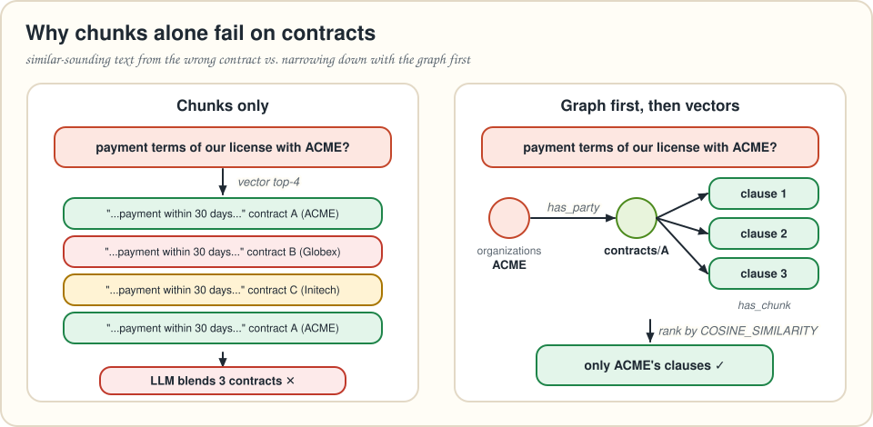
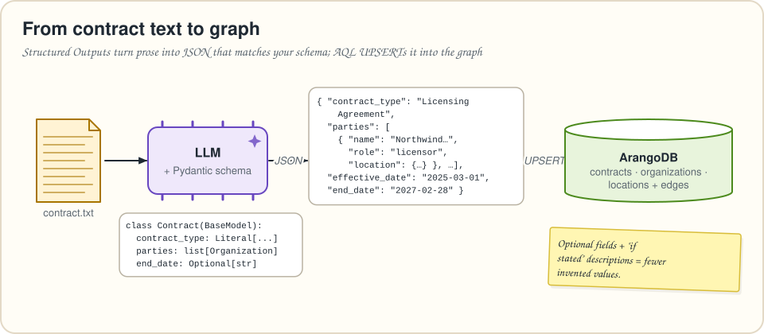
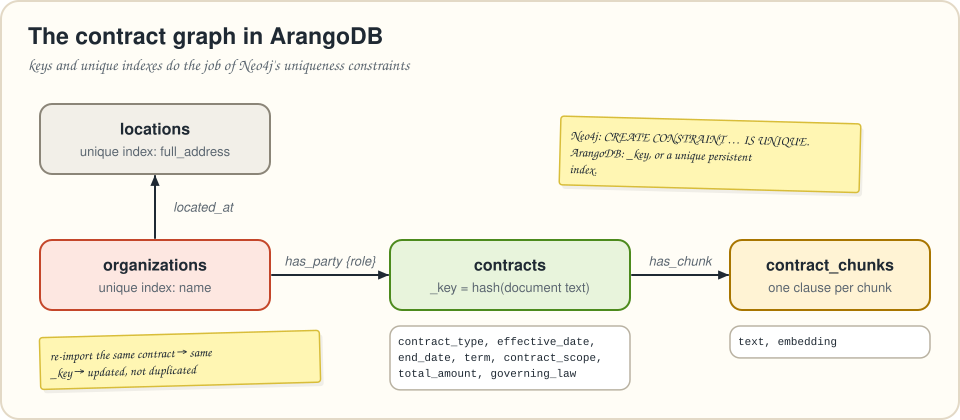
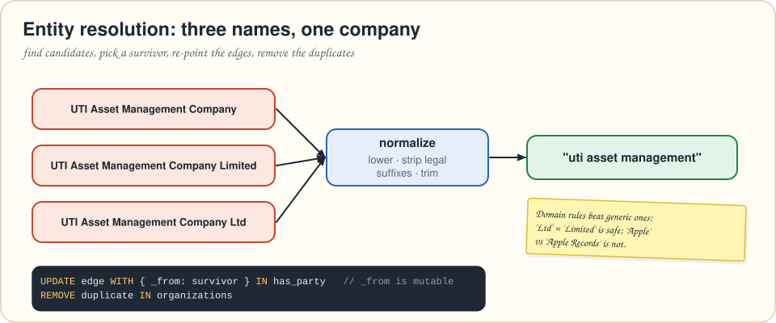

# Chapter 6 · Building knowledge graphs with LLMs

> *Summarizes* Essential GraphRAG *chapter 6, "Constructing knowledge graphs with LLMs." Neo4j constraints and `MERGE` become ArangoDB keys, unique indexes and `UPSERT`.*
> **Run it:** `python code/ch06_contract_kg.py` (uses `code/data/sample_contract.txt`) or `python code/ch06_contract_kg.py path/to/contract.txt`

Up to now we've *queried* graphs. This chapter *builds* one: you're on the data team for a legal chatbot, and your job is to turn a stack of contracts into a knowledge graph that the retrievers from chapters 4–5 can work with.

---

## Why chunks aren't enough for contracts

Two questions break plain chunk retrieval:

1. **"What are the payment terms in our license agreement with ACME?"** Every contract has a payment clause, and they all *sound alike*. The top-k chunks can come from **different contracts**, and the LLM happily blends them into one confident, wrong answer.
2. **"How many active contracts do we have with ACME?"** That's a business-intelligence question: **filter** by party and status, then **count**. Embeddings retrieve similar text. They don't filter, sort or count.



Both need **structure**: which contract belongs to whom, with which dates. Extracting that by hand from thousands of documents is slow and expensive. LLMs are very good at it.

---

## Structured Outputs: JSON you can trust

Information extraction used to mean pipelines of specialized ML models and a team to maintain them. Now you can *describe* the output you want and let an LLM fill it in. OpenAI's **Structured Outputs** feature guarantees the response matches a schema, and in Python you write that schema as a **Pydantic** model:

```python
class Location(BaseModel):
    """A physical location: street address, city, state or region, and country."""
    address: Optional[str] = Field(..., description="Street address, if stated.")
    city: Optional[str] = Field(..., description="City, if stated.")
    state: Optional[str] = Field(..., description="State or region, if stated.")
    country: str = Field(..., description="Country as a two-letter ISO 3166 code, e.g. US, GB.")

class Organization(BaseModel):
    """An organization that is a party to the contract."""
    name: str = Field(..., description="The organization's name as written in the contract.")
    location: Location = Field(..., description="The organization's primary location.")
    role: str = Field(..., description="Its role in the contract, e.g. 'provider', 'client', "
                                       "'licensor', 'licensee', 'supplier'.")

class Contract(BaseModel):
    """The key facts of a contract."""
    contract_type: Literal["Service Agreement", "Licensing Agreement",
                           "Non-Disclosure Agreement (NDA)", "Partnership Agreement",
                           "Lease Agreement"] = Field(..., description="The kind of contract.")
    parties: list[Organization] = Field(..., description="All parties, with their roles.")
    effective_date: str = Field(..., description="When the contract takes effect, yyyy-MM-dd.")
    term: str = Field(..., description="Duration, including renewal or termination provisions.")
    contract_scope: str = Field(..., description="Scope: rights, duties and limitations.")
    end_date: Optional[str] = Field(..., description="When the contract expires, yyyy-MM-dd, if stated.")
    total_amount: Optional[float] = Field(..., description="Total contract value, if stated.")
    governing_law: Optional[Location] = Field(..., description="Jurisdiction whose law governs the contract.")
```

Every design choice here comes from the book's advice:

| Choice | Why |
|---|---|
| **Class names and docstrings** ("The key facts of a contract") | They tell the model *what* it's extracting. |
| **A description on every field**, even obvious ones | The type says "string". The description says "yyyy-MM-dd". There's no date type, so the format lives in the description. |
| **`Optional[...]` for facts that may be absent** (`end_date`, `total_amount`) | If a field is required, some models **invent** a value to fill it. Optional lets them say "not stated". |
| **A fixed list (`Literal`, the book uses an `enum`)** for `contract_type` | You want a closed set of categories you can filter on. |
| **Examples in the description, not an enum,** for `role` | Roles vary, so give hints without closing the set. |
| **Nested objects** (`Location`), but not too deep | Structure helps, but deep nesting hurts extraction quality. |
| **Standards** ("two-letter ISO code") | The model knows ISO codes, and you get consistent, joinable values. |

Before writing any of this, the book insists you **talk to a domain expert and to end users**: the expert knows which facts matter, and the users know which questions they'll ask.

The extraction call is a system message plus the raw document:

```python
SYSTEM_MESSAGE = """You extract structured facts from legal contracts.
Identify the parties and their roles, the key dates, the term, the scope and the
governing law. Be concise: skip boilerplate. If a fact is not in the contract,
leave it empty rather than guessing. The output feeds a database that answers
questions about the company's contracts."""

def extract(document: str) -> dict:
    contract = llm.parse([{"role": "system", "content": SYSTEM_MESSAGE},
                          {"role": "user", "content": document}], Contract)   # chat.completions.parse
    return contract.model_dump()
```

There's no perfect recipe for the system message. The book's advice: define the domain, say how the output will be used, then iterate.

### The book's test drive: CUAD

Real contracts are confidential, so the book uses one document from **CUAD**, the Contract Understanding Atticus Dataset (Hendrycks et al., 2021), an expert-annotated corpus of public commercial contracts. From a 1999 licensing agreement, the extraction returns a *Licensing Agreement* between a mortgage company (client, Irvine, California) and a technology provider (provider, San Luis Obispo, California), its effective date, a one-year auto-renewing term, a scope summary and California governing law. It correctly returns **`None` for the end date and total amount**, which the contract doesn't state. That's the `Optional` design working.

Our repo ships a short, **fictional** sample contract (`code/data/sample_contract.txt`) so the scripts run anywhere. For real-world practice, download CUAD (CC BY 4.0) and point the script at any of its contracts.



---

## Constructing the graph



> [!NOTE]
> 🔄 **Translation Station.** The book creates uniqueness **constraints** on `Contract.id`, `Organization.name` and `Location.fullAddress`, then imports with `MERGE`.
> In ArangoDB a document's `_key` is unique by definition, and other attributes get a **unique persistent index**. `UPSERT` plays the role of `MERGE`.

```python
kdb.ensure_persistent_index(db.collection("organizations"), ["name"], unique=True)
kdb.ensure_persistent_index(db.collection("locations"), ["full_address"], unique=True)
```

The import, one query per contract:

```aql
LET c = @contract
LET contract = FIRST(
  INSERT {
    _key: @contract_key,
    contract_type: c.contract_type,
    effective_date: c.effective_date,
    end_date: c.end_date,
    term: c.term,
    contract_scope: c.contract_scope,
    total_amount: c.total_amount,
    governing_law: c.governing_law == null ? null
                   : CONCAT_SEPARATOR(", ", c.governing_law.state, c.governing_law.country)
  } INTO contracts OPTIONS { overwriteMode: "replace" }
  RETURN NEW
)
LET orgs = (
  FOR party IN c.parties
    UPSERT { name: party.name }
    INSERT { name: party.name }
    UPDATE {}
    IN organizations
    RETURN { org: NEW, party }
)
LET placed = (
  FOR o IN orgs
    LET loc = o.party.location
    LET full_address = CONCAT_SEPARATOR(", ", loc.address, loc.city, loc.state, loc.country)
    UPSERT { full_address: full_address }
    INSERT MERGE(loc, { full_address: full_address })
    UPDATE {}
    IN locations
    RETURN { org: o.org, location: NEW, role: o.party.role }
)
LET located = (
  FOR p IN placed
    UPSERT { _from: p.org._id, _to: p.location._id }
    INSERT { _from: p.org._id, _to: p.location._id }
    UPDATE {}
    IN located_at
    RETURN NEW._id
)
FOR p IN placed
  UPSERT { _from: p.org._id, _to: contract._id }
  INSERT { _from: p.org._id, _to: contract._id, role: p.role }
  UPDATE { role: p.role }
  IN has_party
  RETURN { contract: contract._key, party: p.org.name, role: p.role }
```

The query is a pipeline of subqueries, each writing one collection once, and each passing its results (with `_id`s) to the next:

1. `contracts`: **insert-or-replace by `_key`**.
2. `organizations`: **UPSERT by name**. Two contracts with the same party share one organization node. That's the point of a graph.
3. `locations`: UPSERT by `full_address`.
4. `located_at` and `has_party` edges: UPSERT by `_from` + `_to`, so re-runs don't duplicate edges. The **role lives on the edge**, because the same organization can be a client in one contract and a provider in another.

> [!WARNING]
> ⚠️ **Watch Out! Two traps the translation fixes.**
> **(1) Idempotency.** The book's import gives every contract a `randomUUID()`, and the authors point out that re-running it *duplicates* contracts. Here the key is a hash of the document text (`content_key(document)`), so the same contract always lands on the same document.
> **(2) Nulls in string building.** The book's Cypher builds `fullAddress` with `+`. In Cypher, `null + ' ' + …` is `null`, so a party with no street address gets a null key. AQL's `CONCAT_SEPARATOR()` **skips null parts**: `"Leeds, GB"`.

Check what you built, the AQL equivalent of eyeballing it in Neo4j Browser:

```aql
FOR c IN contracts
  LET parties = (
    FOR org, edge IN 1..1 INBOUND c has_party
      RETURN { name: org.name, role: edge.role }
  )
  RETURN { type: c.contract_type, effective: c.effective_date, parties }
```

You can also open the ArangoDB web UI (http://localhost:8529 → *Graphs* → `contracts`) to see the graph drawn.

---

## Entity resolution: one company, many spellings



LLM extraction produces the same real-world entity in many spellings: *UTI Asset Management Company*, *… Company Limited*, *… Company Ltd*. Three nodes for one company means wrong counts and missed connections. **Entity resolution** finds and merges them.

The book makes a point worth repeating: **entity resolution is domain-specific.** The thresholds that work for company names fail for gene names. What works is domain rules (ontologies), subject-matter experts reviewing candidates, and feedback loops, combined with string matching, clustering or context-aware ML.

**Step 1: find candidates.** Normalize names and group the ones that collapse together:

```aql
FOR o IN organizations
  LET normalized = TRIM(REGEX_REPLACE(REGEX_REPLACE(LOWER(o.name), @noise, ""), " +", " "))
  COLLECT canonical = normalized INTO group = { key: o._key, name: o.name }
  FILTER LENGTH(group) > 1
  RETURN { canonical, organizations: group }
```

with `@noise = "[.,]|\b(incorporated|inc|corporation|corp|company|co|limited|ltd|llc|plc|gmbh)\b"`, passed as a bind parameter so you don't have to escape backslashes inside AQL strings. For typos rather than suffixes, compare by edit distance:

```aql
FOR a IN organizations
  FOR b IN organizations
    FILTER a._key < b._key
    LET distance = LEVENSHTEIN_DISTANCE(LOWER(a.name), LOWER(b.name))
    FILTER distance <= @max_distance
    RETURN { a: a.name, b: b.name, distance }
```

That's O(n²): fine for thousands of names. For millions, use an ArangoSearch view with an n-gram analyzer (`NGRAM_MATCH`), or embed the names and use the vector index from chapter 2.

**Step 2: merge.** Pick a survivor, re-point every edge, and delete the duplicates. In ArangoDB an edge's `_from`/`_to` are **mutable**, so re-pointing is a plain `UPDATE`:

```aql
LET keep = CONCAT("organizations/", @keep_key)
LET dupes = (FOR k IN @duplicate_keys RETURN CONCAT("organizations/", k))
FOR e IN has_party
  FILTER e._from IN dupes
  UPDATE e WITH { _from: keep } IN has_party
```

Repeat for `located_at`, then `REMOVE` the duplicates (`merge_organizations()` in the script). Put a human in the loop before step 2. A wrong merge is worse than a missed one.

---

## Adding the text back: structured + unstructured

The extracted facts are precise, but they don't contain *everything*. The book's final step links each contract to its **chunks**, so one graph holds both the facts and the original wording. For legal text, the book recommends chunking **by clause** rather than by fixed size, because a clause is a unit of meaning. `split_into_clauses()` splits before headings like `1.`, `2.3` or `ARTICLE`, and falls back to sliding windows when a document has no visible structure.

Now the first question from this chapter has a clean answer: **narrow down with the graph, then rank with vectors.**

```aql
FOR org IN organizations
  FILTER CONTAINS(LOWER(org.name), LOWER(@party))
  FOR contract IN 1..1 OUTBOUND org has_party
    FOR chunk IN 1..1 OUTBOUND contract has_chunk
      LET score = COSINE_SIMILARITY(chunk.embedding, @question_embedding)
      SORT score DESC
      LIMIT @k
      RETURN { contract: contract._key, text: chunk.text, score }
```

Because the graph already shrank the candidates to the clauses of that party's contracts, **exact** `COSINE_SIMILARITY()` is cheap, and no vector index is needed. The second question becomes a filter and a count:

```aql
FOR org IN organizations
  FILTER CONTAINS(LOWER(org.name), LOWER(@party))
  FOR contract IN 1..1 OUTBOUND org has_party
    FILTER contract.end_date == null OR contract.end_date >= @today
    COLLECT WITH COUNT INTO active_contracts
    RETURN active_contracts
```

---

## 🎙️ Tonight's Talk: Schema-first vs. free-form extraction

> **Schema-first (this chapter):** I know exactly what I want: contract type, parties, dates. My output fits straight into a database.
>
> **Free-form (next chapter):** I take whatever entities and relationships the text contains. People, gods, ships, weapons…
>
> **Schema-first:** And then you have 14 slightly different relationships between the same two characters.
>
> **Free-form:** Which I *summarize*. And I find themes you didn't know to ask about.
>
> **Schema-first:** For contracts, invoices and tickets, I win.
>
> **Free-form:** For novels, news and research, I do. See you in chapter 7.

## 🙋 No Such Thing as a Dumb Question

**Q: Can ArangoDB enforce the schema in the database too?**
A: Yes. Collections accept a JSON Schema validation rule (`create_collection(..., schema={...})`), so documents that don't match are rejected. Pydantic validates the LLM output, and the collection schema validates everything else that writes.

**Q: What about contracts longer than the context window?**
A: Extract per section and merge, or extract the high-level facts from the first pages (parties and dates usually live there) and clause-level facts per chunk.

**Q: Why store `role` on the edge and not on the organization?**
A: Roles belong to the *relationship*. Northwind can be a licensor in one contract and a client in another.

## 📌 Key Takeaways

* Chunk retrieval **mixes documents** and **can't filter or count**. Contracts and similar records need **structured extraction**.
* **Structured Outputs** with a **Pydantic** schema: descriptions on every field, `Optional` for facts that may be missing, closed lists for categories, examples for open sets, shallow nesting, ISO standards.
* In ArangoDB, `_key` and **unique indexes** replace uniqueness constraints, and **UPSERT** replaces `MERGE`. Derive keys from content to make imports **idempotent**.
* **Entity resolution** is domain-specific: generate candidates (normalization, edit distance), merge with a human in the loop by **re-pointing edges** and removing duplicates.
* Linking **chunks** to the structured graph enables **graph-scoped vector search**: filter with the graph, then rank by similarity.

## ✏️ Pencil Time

**1 · Model it.** Sketch a Pydantic model for **NDAs**. Which fields are optional? Which deserve a closed list?

**2 · Query it.** Write AQL that lists contracts ending in 2027 with their parties as `"Name (role)"` strings.

<details>
<summary>▸ Solutions</summary>

**1.** For example: `disclosing_party` and `receiving_party` (both `Organization`), `mutual: bool`, `effective_date`, `confidentiality_period_years: Optional[int]`, `excluded_information: Optional[str]`, `governing_law: Optional[Location]`. Use a closed list for `purpose_category` if legal gives you one. Make every fact a contract might omit `Optional`.

**2.**
```aql
FOR c IN contracts
  FILTER c.end_date >= "2027-01-01" AND c.end_date <= "2027-12-31"
  LET parties = (
    FOR org, edge IN 1..1 INBOUND c has_party
      RETURN CONCAT(org.name, " (", edge.role, ")")
  )
  SORT c.end_date
  RETURN { contract: c._key, type: c.contract_type, ends: c.end_date, parties }
```
ISO dates compare correctly as strings. Contracts without an `end_date` drop out, because `null` sorts below every string.

</details>

---
[← Chapter 5](05-agentic-rag.md) · [Contents](../README.md) · [Chapter 7 →](07-microsoft-graphrag.md)
