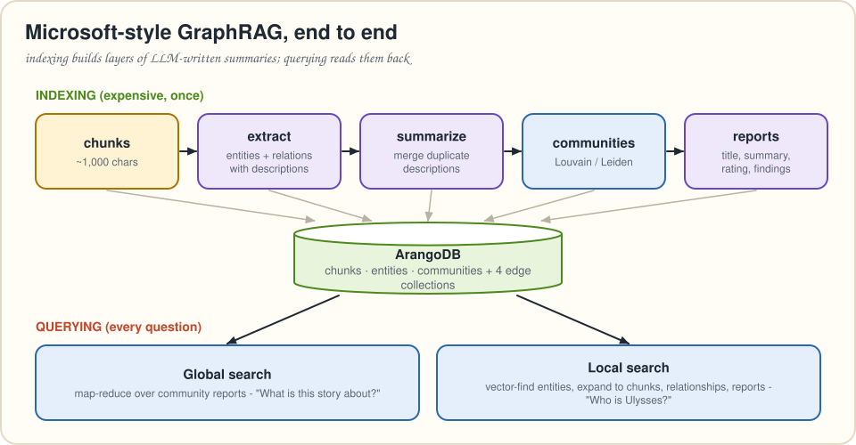
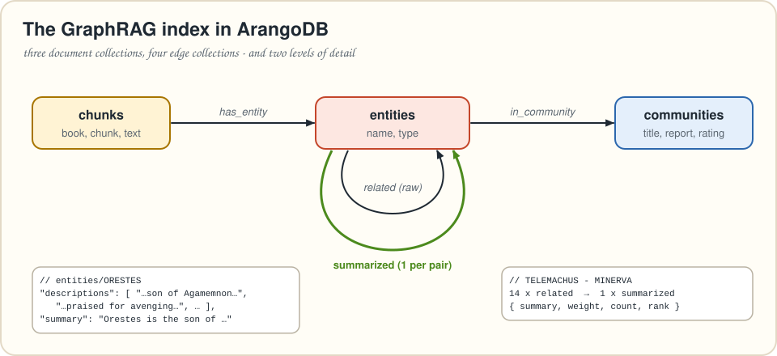
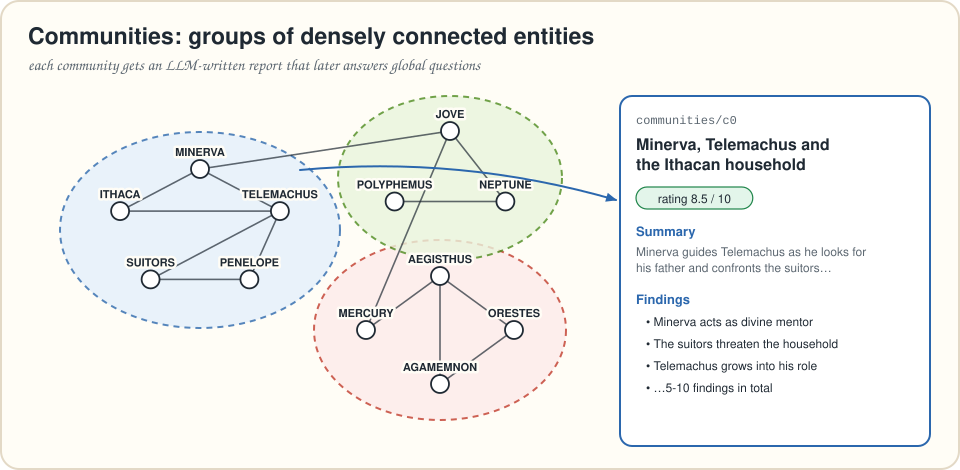
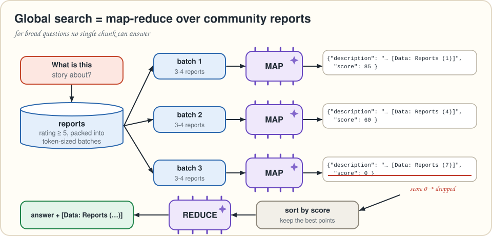
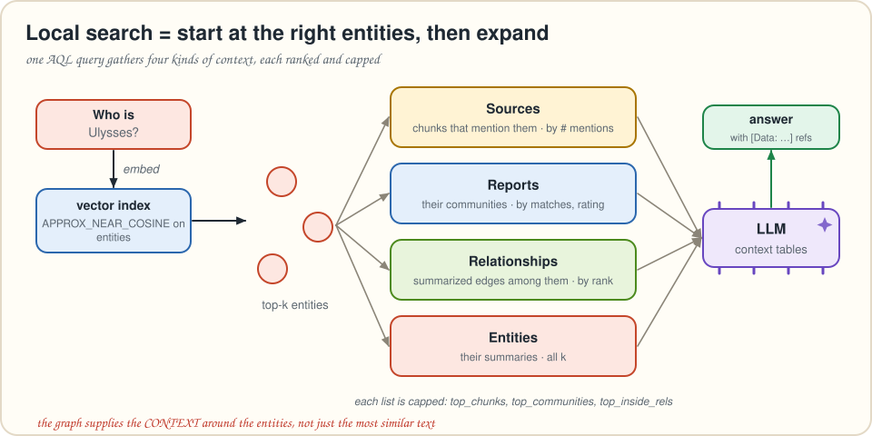

# Chapter 7 · Microsoft's GraphRAG, rebuilt on ArangoDB

> *Summarizes* Essential GraphRAG *chapter 7, "Microsoft's GraphRAG implementation." Neo4j + Graph Data Science become ArangoDB collections + NetworkX community detection, and the book's Cypher retrievers become AQL.*
> **Run it:** `python code/ch07_ms_graphrag.py index --books 1`, then `… global "What is this story about?"` and `… local "Who is Ulysses?"`

Chapter 6 extracted a *fixed* schema from contracts. Now the opposite: read a **story**, extract *whatever* entities and relationships it contains, and build summaries that can answer questions no single chunk can, like **"What is this story about?"**

This is the approach from Microsoft's GraphRAG paper (Edge et al., 2024). Its big idea is that once the knowledge graph exists, you **detect communities** of closely related entities and have the LLM write a **report for each community**. Those reports become an index of themes.



---

## Choosing the data and the entity types

MS GraphRAG extracts entities of **types you define up front**, and those types shape everything downstream. Pick them by exploring the data and listing the questions you want answered. The paper used podcasts and news (people, organizations, locations, plus topic-specific types). The book picks **Homer's *The Odyssey*** (Samuel Butler's translation from Project Gutenberg, with Roman names: Ulysses, Minerva, Jove). It's full of people, gods, places and weapons, and its key characters show up across many chunks. That's exactly what cross-chunk summarization needs.

The chosen types: `PERSON, ORGANIZATION, LOCATION, GOD, EVENT, CREATURE, WEAPON_OR_TOOL`. Some are crisp (PERSON, GOD). Others are fuzzy: is an EVENT a single blow or the whole Trojan War? Is a LOCATION a country, a city or a room in a palace? Fuzzy types give the LLM freedom and give you less consistency.

> [!IMPORTANT]
> 🧠 **Brain Bender (the book's Exercise 7.1).** Before reading the list above, which entity types would *you* choose for The Odyssey? What questions would each type help answer?

---

## Stage 1 · Building the entity graph

### Chunking

The text has 24 "books". Strip the prefaces and footnotes and split on the book headings. The books average about **6,500 tokens** (4,459 to 10,760), which is too big for good extraction. The paper measured why: **smaller chunks yield more extracted entities** (600-token chunks beat 1,200 beat 2,400), and so do **more "gleaning" passes**, where you ask the LLM again for what it missed. The book chunks each book with `chunk_text(book, 1000, 40)`.

```python
def split_into_books(raw: str) -> list[str]:
    """Cut the Gutenberg header/footer, then split on body headings 'BOOK I' ... 'BOOK XXIV'."""
    start, end = raw.find("*** START OF"), raw.find("*** END OF")
    text = raw[max(start, 0): end if end > 0 else None]
    headings = list(re.finditer(r"^BOOK [IVXL]+\s*$", text, flags=re.M))
    if not headings:
        return []
    footnotes = text.rfind("\nFOOTNOTES")
    if footnotes > headings[-1].start():
        text = text[:footnotes]
    parts = re.split(r"^BOOK [IVXL]+\s*$", text, flags=re.M)
    return [p.strip() for p in parts[1:] if p.strip()]
```

### Extracting entities and relationships

The book reuses the extraction prompt from the paper's appendix. Its structure:

* **Goal**: find all entities of the given types and all relationships among them.
* **Step 1, entities**: name (capitalized), type (from the list), and a *comprehensive description* of the entity's attributes and actions, formatted as `("entity"<|>NAME<|>TYPE<|>description)`.
* **Step 2, relationships**: source, target, an explanation of *why* they're related, and a numeric **strength**, formatted as `("relationship"<|>SOURCE<|>TARGET<|>description<|>strength)`.
* **Steps 3–4**: one list joined with a record delimiter (`##`), ending with a completion marker (`<|COMPLETE|>`).
* The full prompt adds few-shot examples (`code/ch07_ms_graphrag.py` has its own compact version).

Note what's *different* from chapter 6: both entities and relationships carry **free-text descriptions**. A relationship isn't just `MENTORS`. It's "Minerva, disguised as Mentes, advises Telemachus to seek news of his father." Descriptions are what the summaries are built from later.

```python
def extract_entities(text: str, gleanings: int = 0):
    prompt = EXTRACTION_PROMPT.format(entity_types=", ".join(ENTITY_TYPES), text=text,
                                      t="<|>", r="##", done="<|COMPLETE|>")
    messages = [{"role": "user", "content": prompt}]
    output = llm.chat(messages)
    messages.append({"role": "assistant", "content": output})
    for i in range(gleanings):            # "MANY entities were missed..." - ask again
        messages.append({"role": "user", "content": GLEAN_CONTINUE})
        more = llm.chat(messages)
        messages.append({"role": "assistant", "content": more})
        output += "##" + more
        if i == gleanings - 1 or llm.chat(messages + [{"role": "user", "content": GLEAN_CHECK}])[:1].upper() != "Y":
            break
    return parse_extraction(output)       # -> {NAME: {type, descriptions}}, [relationships]
```

### Storing it in ArangoDB



> [!NOTE]
> 🔄 **Translation Station.** The book labels every entity node twice (`:__Entity__:PERSON`), stores descriptions in a list property, and links chunks to entities. In ArangoDB, all entities go into **one** `entities` collection with a `type` attribute (no multi-labels needed), keyed by the upper-cased name. Raw relationships become documents in the `related` edge collection: **one edge per extracted relationship**, so a pair can have many.

```aql
LET chunk = FIRST(
  INSERT { _key: @chunk_key, book: @book, chunk: @chunk, text: @text }
  INTO chunks OPTIONS { overwriteMode: "replace" }
  RETURN NEW
)
LET found = (
  FOR e IN @entities
    UPSERT { _key: e.key }
    INSERT { _key: e.key, name: e.name, type: e.type, descriptions: e.descriptions }
    UPDATE { descriptions: UNION_DISTINCT(OLD.descriptions, e.descriptions) }
    IN entities
    RETURN NEW._id
)
FOR id IN found
  INSERT { _key: CONCAT(chunk._key, "-", PARSE_IDENTIFIER(id).key), _from: chunk._id, _to: id }
  INTO has_entity OPTIONS { overwriteMode: "ignore" }
```

The key move is `UPDATE { descriptions: UNION_DISTINCT(OLD.descriptions, e.descriptions) }`. When ORESTES shows up in a new chunk, his new descriptions are **appended**, not overwritten (`OLD` is the document before the update). After extracting all chunks, each entity holds *every* description the LLM ever wrote about it.

```aql
FOR r IN @relationships
  LET source = CONCAT("entities/", r.source)
  LET target = CONCAT("entities/", r.target)
  FILTER DOCUMENT(source) != null AND DOCUMENT(target) != null
  INSERT { _key: r.key, _from: source, _to: target, description: r.description,
           strength: r.strength, chunk: @chunk_key }
  INTO related OPTIONS { overwriteMode: "ignore" }
```

LLMs sometimes describe a relationship to an entity they never listed. The book's Cypher silently skips those (its `MATCH` finds nothing), and `FILTER DOCUMENT(…) != null` does the same here.

### What did we get?

For Book I alone, the book's run produced **66 entities and 182 relationships** (numbers vary from run to run). Two queries show the shape of the data:

```aql
FOR e IN entities
  FILTER e.name == @name
  RETURN e.descriptions
```

ORESTES has half a dozen descriptions: "Agamemnon's son who killed Aegisthus", "expected to take revenge on Aegisthus", "praised for avenging his father's murder"… They're redundant, but together they're complete.

```aql
FOR r IN related
  LET pair = r._from < r._to ? [r._from, r._to] : [r._to, r._from]
  COLLECT p = pair INTO descriptions = r.description
  SORT LENGTH(descriptions) DESC
  LIMIT 1
  RETURN { source: DOCUMENT(p[0]).name, target: DOCUMENT(p[1]).name,
           count: LENGTH(descriptions), descriptions }
```

The busiest pair is **Telemachus and Minerva, with 14 relationships**: he speaks quietly to her at the banquet, she (disguised as Mentes) encourages him, she sends his mother to sleep… The `pair` trick sorts the two ids, so A→B and B→A count as the same pair.

---

## Stage 1½ · Summarizing descriptions

Fourteen overlapping sentences are noise. MS GraphRAG asks the LLM to **merge** each entity's descriptions, and each pair's relationship descriptions, into one coherent summary. The prompt asks for one comprehensive description that includes everything, resolves contradictions, is written in the third person, and names the entities so it stands on its own.

```aql
FOR e IN entities
  FILTER LENGTH(e.descriptions) > 1
  RETURN { key: e._key, name: e.name, descriptions: e.descriptions }
```

Entities with a single description just copy it to `summary`. For relationships, we group raw edges by pair, summarize the ones with several descriptions, and store **one `summarized` edge per pair** with its `summary`, a `weight` (sum of strengths) and a `count`:

```aql
FOR r IN related
  LET pair = r._from < r._to ? [r._from, r._to] : [r._to, r._from]
  COLLECT p = pair INTO rels = { description: r.description, strength: r.strength }
  RETURN { source: p[0], target: p[1], names: [DOCUMENT(p[0]).name, DOCUMENT(p[1]).name],
           descriptions: UNIQUE(rels[*].description), weight: SUM(rels[*].strength),
           count: LENGTH(rels) }
```

Finally each summarized edge gets a **rank = degree(source) + degree(target)**. That's MS GraphRAG's heuristic: relationships between well-connected entities matter more, and local search will use it.

> [!WARNING]
> ⚠️ **Watch Out! Super nodes.** On a bigger corpus, say all of Greek history, an entity like ATHENS collects thousands of descriptions. Summarizing them all may not fit in the prompt and would produce a bloated summary anyway. **Rank and filter** descriptions first (most recent, most frequent, from the most relevant chunks) before summarizing.

---

## Stage 2 · Communities and their reports



A **community** is a group of entities more densely connected to each other than to the rest of the graph. In a story, communities tend to form around a place, a family or an episode. Find them, summarize each, and you have the *themes* of the corpus.

> [!NOTE]
> 🔄 **Translation Station.** The book runs **Louvain** from Neo4j's Graph Data Science library (the paper used **Leiden**, hierarchically). ArangoDB 3.12 no longer ships its Pregel graph-analytics engine. So we do what many ArangoDB users do: **export the edges with AQL, run the algorithm in Python, write the results back.** For big graphs, look at `nx-arangodb` (ArangoDB's NetworkX backend) or the graph analytics services of Arango's managed platform.

```python
def detect_communities(db, seed: int = 42) -> list[int]:
    graph = nx.Graph()
    for e in kdb.aql(db, "FOR s IN summarized RETURN { source: s._from, target: s._to, weight: s.weight }"):
        graph.add_edge(e["source"], e["target"], weight=e["weight"] or 1.0)
    found = nx.community.louvain_communities(graph, weight="weight", seed=seed)   # or leiden_communities
    communities = [{"key": f"c{i}", "members": sorted(c)} for i, c in enumerate(found) if len(c) > 1]
    ...  # write `communities` docs + `in_community` edges with one AQL query
```

The book's run found **9 communities with 2 to 13 entities each**. Louvain isn't deterministic, so results change between runs unless you fix the seed, as we do.

> [!TIP]
> 😌 **Relax: hierarchy is optional here.** The paper uses the *hierarchical* structure of community detection: big communities at the top, finer ones below. Microsoft's implementation recursively splits any community larger than a maximum size (10 entities by default). On one book of The Odyssey, a single level is plenty, and the book skips the hierarchy too.

### Community reports

For each community, the LLM gets its entities (name, type, summary) and its internal relationships (summaries), and writes a report. The paper's prompt frames it as **information discovery for an analyst** and asks for:

* **TITLE**: short, specific, naming key entities.
* **SUMMARY**: an executive summary of the structure and relationships.
* **IMPACT SEVERITY RATING**: a float from 0 to 10 for how important the community is.
* **RATING EXPLANATION**: one sentence.
* **DETAILED FINDINGS**: 5–10 insights, each grounded in the data.

```aql
WITH entities
FOR c IN communities
  LET members = (FOR e IN 1..1 INBOUND c in_community RETURN e)
  LET member_ids = members[*]._id
  LET rels = (
    FOR m IN members
      FOR other, r IN 1..1 OUTBOUND m summarized
        FILTER other._id IN member_ids
        SORT r.rank DESC
        RETURN { source: m.name, target: other.name, description: r.summary }
  )
  RETURN {
    community: c._key,
    entities: members[* RETURN { name: CURRENT.name, type: CURRENT.type, description: CURRENT.summary }],
    relationships: rels
  }
```

`members[* RETURN {...}]` is an **inline projection**: map every element, with `CURRENT` as the loop variable. `FILTER other._id IN member_ids` keeps only relationships *inside* the community.

The largest community in the book's run was titled **"Minerva, Telemachus, and the Ithacan Household"**: divine guidance, family loyalty and the trouble with the suitors.

> [!WARNING]
> ⚠️ **Watch Out! Giant communities.** Like super nodes, a huge community won't fit in one report prompt. Rank its entities and relationships (degree and rank work well) and include only the top ones.

---

## Querying the index

### Global search: map-reduce over reports



"What is this story about?" has no *relevant chunk*. The answer is spread over the whole book. **Global search** answers from the community reports instead:

1. **Select** reports, here those rated `>= 5` (`GLOBAL_COMMUNITIES`).
2. **MAP**: give each report (or batch of reports) and the question to the LLM, which returns **key points with an importance score (0–100)** and references like `[Data: Reports (3)]`. "I don't know" points score 0.
3. **REDUCE**: drop zero-score points, sort the rest by importance, and have the LLM write the final answer in the requested length and format. Keep the references (at most 5 ids each, then "+more") and **never make anything up**.

```aql
FOR c IN communities
  FILTER c.rating >= @min_rating
  SORT c.rating DESC
  RETURN { id: c._key, title: c.title, content: c.full_content }
```

The book makes one MAP call per community. Our version **packs reports into ~6,000-token batches** first, as Microsoft's implementation does, so a large index needs far fewer calls. The answer to "What is this story about?" weaves together Minerva guiding Telemachus, the suitors troubling Ulysses' household, the Orestes/Aegisthus story told by Jove, and the gods' influence on human affairs, each claim with its report references.

> [!IMPORTANT]
> 🧠 **Brain Bender.** With hierarchical communities, which level should global search read? *Lower levels give more detailed reports and better answers, but many more LLM calls. Higher levels are cheap but coarse. Pick per use case.*

### Local search: anchor on entities, then expand



For entity-focused questions ("Who is Ulysses?"), start from the **entities most similar to the question**, then pull in their context. First, embed each entity's summary and add a vector index:

```python
rows = kdb.aql(db, "FOR e IN entities FILTER e.summary != null RETURN { key: e._key, text: CONCAT(e.name, ': ', e.summary) }")
...  # embed, save, then:
kdb.ensure_vector_index(db.collection("entities"), "embedding", dimension=1536, sparse=True)
```

Then one AQL query builds the whole context:

```aql
WITH entities, chunks, communities
LET nodes = (
  FOR e IN entities
    LET score = APPROX_NEAR_COSINE(e.embedding, @question_embedding)
    SORT score DESC
    LIMIT @k
    RETURN { id: e._id, key: e._key, name: e.name, type: e.type, summary: e.summary }
)
LET node_ids = nodes[*].id
LET sources = (
  FOR n IN nodes
    FOR ch IN 1..1 INBOUND n.id has_entity
      COLLECT chunk_id = ch._id WITH COUNT INTO mentions
      SORT mentions DESC
      LIMIT @top_chunks
      RETURN { id: PARSE_IDENTIFIER(chunk_id).key, text: DOCUMENT(chunk_id).text, mentions }
)
LET reports = (
  FOR n IN nodes
    FOR c IN 1..1 OUTBOUND n.id in_community
      COLLECT community_id = c._id WITH COUNT INTO matched
      LET community = DOCUMENT(community_id)
      SORT matched DESC, community.rating DESC, community.weight DESC
      LIMIT @top_communities
      RETURN { id: community._key, title: community.title, summary: community.summary }
)
LET relationships = (
  FOR n IN nodes
    FOR other, r IN 1..1 OUTBOUND n.id summarized
      FILTER other._id IN node_ids
      SORT r.rank DESC, r.weight DESC
      LIMIT @top_inside_rels
      RETURN { id: r._key, source: n.name, target: other.name, description: r.summary }
)
RETURN {
  entities: nodes[* RETURN { id: CURRENT.key, entity: CURRENT.name, type: CURRENT.type,
                             description: CURRENT.summary }],
  relationships,
  reports,
  sources
}
```

Four context lists, each **ranked and capped** so the prompt stays a manageable size:

| List | Ranked by | Why |
|---|---|---|
| **Sources** (chunks) | how many of the matched entities each chunk mentions | A chunk mentioning three relevant entities beats one mentioning one. |
| **Reports** | number of matched entities in the community, then rating, then weight | The communities these entities live in supply the bigger picture. |
| **Relationships** (between matched entities) | rank (combined degree), then weight | Important links first. |
| **Entities** | vector similarity | They're the anchors. |

(The book orders reports by the community's rank and weight. We follow MS GraphRAG's heuristic of preferring communities that contain more of the matched entities. Same spirit.)

The four lists are formatted as small tables with ids, and the **local search prompt** asks for an answer that cites them: `[Data: Entities (5, 7); Relationships (23); Reports (2); Sources (4)]`. The ids make every claim traceable to the graph.

> [!TIP]
> 😌 **Relax: you can mix and match.** Once this index exists, more retrievers come cheap. The book suggests **embedding community summaries** as their own vector retriever: "find the themes most similar to this question".

---

## Beyond the book

* **DRIFT search** (Microsoft, 2024) blends the two: it starts from community reports, the way global search does, then issues local follow-up queries to drill down.
* **LazyGraphRAG** (Microsoft, 2024) defers the expensive LLM summarization from indexing time to query time. Indexing costs about the same as plain vector RAG, at the price of more work per query.
* **Arango's own GraphRAG.** Arango's commercial platform includes managed services that automate this pipeline: document import, entity/relationship extraction and communities, plus retrieval services. Building it by hand first, as here, is how you learn what those knobs do.

---

## 🎙️ Tonight's Talk: Global search vs. Local search

> **Global:** Ask me anything broad: themes, conflicts, "what's going on here". I read *every* community report.
>
> **Local:** Which costs a dozen LLM calls. Ask me about Ulysses and I make one.
>
> **Global:** And if they ask "What are the central conflicts in this story?"
>
> **Local:** I'd find the five entities closest to "conflict"… and miss the big picture. Fine.
>
> **Global:** And for "Who is Ulysses?" I'd summarize every community that mentions him at length.
>
> **Both:** So route: broad → global, specific → local. That's chapter 5's router again.

## 🙋 No Such Thing as a Dumb Question

**Q: Isn't indexing expensive?**
A: Yes. Every chunk needs an extraction call (plus gleanings), every multi-description entity and pair needs a summary, and every community needs a report. That's why the book processes *one* of the 24 books. Use a cheap model for extraction and summaries, batch where you can, and cache results by content hash, as our keys already do.

**Q: Why not use Structured Outputs (chapter 6) for extraction?**
A: You can, and it parses more reliably. The delimiter format comes from the paper and works with any model that can follow a format. For a strict schema, use structured outputs. For open-ended exploration, the delimiter prompt is fine.

**Q: Why are entity names UPPER CASE?**
A: The prompt asks for capitalized names, so "Minerva" and "MINERVA" merge into one entity. It's the cheapest possible entity resolution. Real corpora still need chapter 6's tricks.

**Q: Can't I run community detection inside ArangoDB?**
A: Not in ArangoDB 3.12: its Pregel engine was removed. Exporting a few thousand edges to NetworkX takes milliseconds. For large graphs, use `nx-arangodb` or a dedicated graph analytics service.

## 📌 Key Takeaways

* MS GraphRAG builds the graph in **two stages**: (1) LLM extraction of entities and relationships **with descriptions**, then LLM **summarization** of duplicates; (2) **community detection** plus an LLM-written **report per community**.
* **Entity types are chosen up front** and shape everything. **Smaller chunks** and **gleaning passes** extract more entities.
* In ArangoDB: one `entities` collection (type as an attribute), **raw `related` edges** (many per pair) plus **one `summarized` edge per pair**, and `communities` linked via `in_community`. `UPSERT … UPDATE { descriptions: UNION_DISTINCT(OLD.descriptions, …) }` accumulates descriptions.
* Community detection runs in **NetworkX** (Louvain/Leiden) on edges exported with AQL. Results are written back as documents and edges.
* **Global search** = map-reduce over reports, for broad questions. **Local search** = vector search for entities, then one AQL query that expands to ranked chunks, reports and relationships, for entity questions.
* Watch for **super nodes** and **giant communities**: rank, then cap.

## ✏️ Pencil Time

1. You're indexing a company wiki. Which **entity types** would you choose, and why?
2. Write AQL: which communities contain both `ULYSSES` and `MINERVA`?
3. Write AQL: the five best-connected entities.

<details>
<summary>▸ Solutions</summary>

**1.** For example: PERSON, TEAM, PRODUCT, SERVICE, PROJECT, CUSTOMER, DOCUMENT, DECISION. Pick types that match the questions people ask ("who owns X?", "what depends on Y?"). Avoid vague catch-alls like CONCEPT unless you also plan to summarize them.

**2.**
```aql
WITH entities
FOR c IN communities
  LET members = (FOR e IN 1..1 INBOUND c in_community RETURN e.name)
  FILTER "ULYSSES" IN members AND "MINERVA" IN members
  RETURN { community: c._key, title: c.title }
```

**3.** We stored `degree` during summarization:
```aql
FOR e IN entities
  SORT e.degree DESC
  LIMIT 5
  RETURN { name: e.name, type: e.type, degree: e.degree }
```

</details>

---
[← Chapter 6](06-building-knowledge-graphs.md) · [Contents](../README.md) · [Chapter 8 →](08-evaluation.md)
