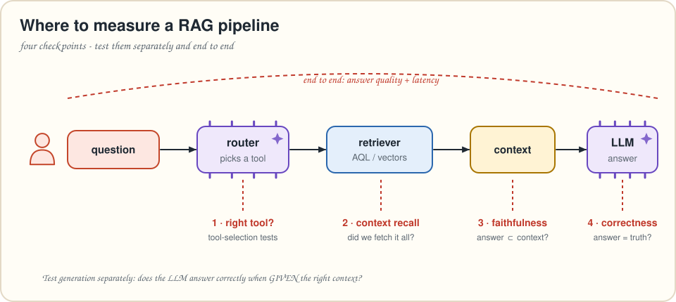
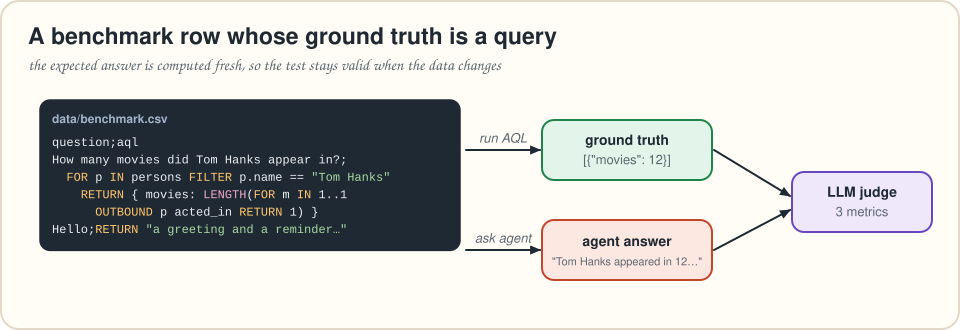
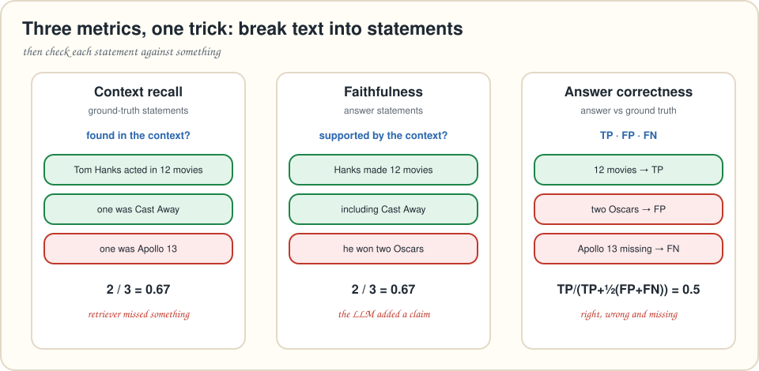

# Chapter 8 · Evaluating your RAG system

> *Summarizes* Essential GraphRAG *chapter 8, "RAG application evaluation." Cypher ground truths become AQL ground truths. The metrics are computed by a small built-in judge, with RAGAS as an option.*
> **Run it:** `python code/load_movies.py` (once), then `python code/ch08_evaluation.py`

Every chapter so far added a moving part: a rewriter, a router, a critic, a query generator. Each one *probably* helps. "Probably" doesn't survive the first production incident. A **benchmark** turns "probably" into a number and does one more job: it **defines what your agent is supposed to do**.

---

## Where to measure



The book splits the pipeline into checkpoints:

1. **Tool selection.** Did the router pick the right retriever? (Vector search for fuzzy text, an AQL template for known patterns, text2aql for everything else.)
2. **Retrieved context.** Is it relevant, and does it contain *everything* needed?
3. **Answer generation.** Is the answer correct and coherent? An important special case: **given the correct context, does the LLM produce the correct answer?** That separates *reasoning* problems from *retrieval* problems.
4. **End to end.** Does the whole thing give good answers fast enough?

When a test fails, the checkpoint tells you *which* part to fix.

## Designing the benchmark

A good benchmark covers every capability and every known edge case. The book's categories:

| Category | Example questions | What it tests |
|---|---|---|
| **Tool selection** | "Who acted in Top Gun?" | the specialized tool, not text2aql |
| **Entity & value mapping** | "Who acted in **top gun**?", "…did **tom Hanks** act in?" | user spelling → database values |
| **Aggregation / filtering** (text2aql) | "Who acted in the most movies?", "List people born before 1940." | generated queries |
| **Multi-step retrieval** | questions whose second lookup depends on the first | the query updater and critic |
| **Edge cases** | "Which movie has the most Oscars?" (not in the data) | saying "missing" instead of inventing |
| **Conversational usability** | "Hello", "What can you do?", "What's the weather in Spain?" | greeting, scoping, refusing politely |

### Ground truth as a *query*



The book's best idea in this chapter: **don't store the expected answer, store the query that computes it.** If someone adds a Tom Hanks movie tomorrow, the expected answer updates itself. Static expectations (greetings, refusals) become a query that returns a string. Our `code/data/benchmark.csv`:

```text
question;aql
Hello;RETURN "a greeting and a reminder that it can only answer questions about movies"
How many movies are there?;RETURN { movies: COLLECTION_COUNT("movies") }
List people born before 1940.;FOR p IN persons FILTER p.born != null AND p.born < 1940 SORT p.name RETURN p.name
Which movie has the most Oscars?;RETURN "This information is missing"
...
```

Two AQL ground truths, written out:

```aql
FOR e IN acted_in
  COLLECT actor = e._from WITH COUNT INTO movie_count
  SORT movie_count DESC
  LIMIT 1
  RETURN { name: DOCUMENT(actor).name, movie_count }
```

```aql
FOR p IN persons
  FILTER LENGTH(FOR m IN 1..1 OUTBOUND p acted_in LIMIT 1 RETURN 1) > 0
  SORT CHAR_LENGTH(p.name) DESC
  LIMIT 1
  RETURN p.name
```

The first counts **edges** directly, which is faster than walking from every person. The second is the question the book's agent *failed* on (more on that below).

We kept the book's question *types*. We replaced the one about "votes", a property the Movies data doesn't have, with a year-range question, and added **"Who directed the most movies?"** with a ground truth that returns *every* director tied for first place. The tie between the Wachowskis (chapter 4) is a good test of whether your agent mentions both. That makes 18 rows.

> [!WARNING]
> ⚠️ **Watch Out! Your ground truth is code, so test it.** A wrong ground-truth query fails every run and teaches you nothing. `selftest.py` runs every benchmark query and checks the answers we know (12 Tom Hanks movies, "Philip Seymour Hoffman" for the longest actor name, and so on).

---

## Three metrics



The book uses **RAGAS**, a RAG evaluation framework. All three metrics are **LLM-as-judge** metrics, and they share one trick: *break text into small statements, then check each one*.

| Metric | Question it answers | How |
|---|---|---|
| **Context recall** | Did retrieval fetch *everything* needed? | Split the **ground truth** into statements and count how many can be attributed to the retrieved context. |
| **Faithfulness** | Does the answer stick to the context? | Split the **answer** into atomic statements (no pronouns) and check each against the context. Unsupported = hallucinated, *even if it's true in the real world*. |
| **Answer correctness** | Is the answer right and complete? | Split answer and ground truth into statements, classify **TP** (in both), **FP** (answer only) and **FN** (ground truth only), and combine them like an F1 score. |

Our `ch08_evaluation.py` implements the three with short judge prompts, so you can see and tweak them:

```python
def faithfulness(question, answer, contexts):
    return supported_share(statements(question, answer), "\n".join(contexts))

def answer_correctness(question, answer, reference):
    out = llm.chat_json([{"role": "system", "content": CORRECTNESS_PROMPT},
                         {"role": "user", "content": json.dumps({
                             "question": question,
                             "answer_statements": statements(question, answer),
                             "ground_truth_statements": statements(question, reference)})}])
    tp, fp, fn = (len(out.get(k, [])) for k in ("TP", "FP", "FN"))
    return tp / (tp + 0.5 * (fp + fn)) if tp else 0.0
```

> [!TIP]
> 😌 **Relax: RAGAS is still an option.** `evaluate_with_ragas()` in the same file runs the RAGAS 0.4 versions of the three metrics. Note the 0.4 column names: `user_input`, `retrieved_contexts`, `response` and `reference`. RAGAS' answer correctness also blends in semantic similarity, so its numbers won't match our judge exactly. Pin your versions, because RAGAS' dependencies move fast.

## Running it

```python
for row in rows:
    reference = json.dumps(kdb.aql(db, row["aql"]))           # live ground truth
    start = time.perf_counter()
    answer, context = agent.get_answer(row["question"])        # chapter 5's agent
    latency = time.perf_counter() - start
    contexts = [m["content"] for m in context]                 # what the agent saw
    ...  # score the three metrics, save everything to results/benchmark_results.csv
```

Record **latency** and **retrieved contexts** alongside the answer. Without the contexts you can't compute recall or faithfulness, and without latency you can't see what each tool costs.

## What the book found

On its 17-question benchmark the book's agent scored:

| answer correctness | context recall | faithfulness |
|---|---|---|
| **0.7774** | **0.7941** | **0.9657** |

* **Faithfulness is excellent.** The model rarely adds anything that isn't in the context.
* **Correctness and recall are lower**, and they move together. When the answer is wrong, it's usually because **retrieval didn't fetch what was needed**. Improve retrieval first (better tools, query rewriting, entity mapping), not the prompt.
* **Latency is much lower when text2cypher isn't needed.** That's one LLM call fewer, and another reason to promote frequent patterns to specialized tools.
* **The judge is an LLM too.** Some scores look odd (the book's "Hello" example). Read the per-row results, not just the averages.
* **A clear failure:** "Who has the longest name among all actors?" The generator couldn't write the query. Fix it with a few-shot example or a dedicated tool, re-run the benchmark, and watch the number move.

The benchmark should **grow with the system**: every bug report becomes a new row.

---

## Where to go next (the book's closing thoughts)

LLMs keep getting better at using tools, but their results are only as good as **the tools you give them**. That's your job. You now have the patterns for both kinds of data: **embed** text for fast similarity retrieval, and **extract** entities, relationships and events into a graph for precise, multi-hop questions. Combine them, measure them, and keep improving.

---

## 🎙️ Tonight's Talk: Faithfulness vs. Correctness

> **Faithfulness:** I scored 0.97. I'm basically perfect.
>
> **Correctness:** You'd score 1.0 for answering "I don't know" from an empty context.
>
> **Faithfulness:** …and you'd score 1.0 for a lucky guess that the retriever never supported.
>
> **Context recall:** Which is why you need me. If I'm low, neither of you can be trusted to improve.
>
> **All three:** Read us together.

## 🙋 No Such Thing as a Dumb Question

**Q: Isn't it circular to have an LLM grade an LLM?**
A: Partly. Judges are inconsistent, and they share blind spots with the model being judged. Use a strong judge model, keep the judge prompts fixed between runs, and spot-check by hand. For yes/no facts (counts, names), add exact-match checks.

**Q: How many test questions do I need?**
A: Enough to cover every tool and every known failure mode. The book used 17. Ten good questions beat a thousand generated ones you never read.

**Q: Doesn't an AQL ground truth only test text2aql?**
A: No. The *agent* answers in natural language through whichever tool it picks. The AQL just computes what the right answer *is*.

## 📌 Key Takeaways

* Evaluate at checkpoints: **tool selection, retrieved context, generation (given good context), end to end**, plus **latency**.
* A good benchmark covers **tools, value mapping, aggregations, multi-step questions, edge cases and conversational behavior**.
* Store **ground truth as AQL**, so expectations update with the data. Static answers are `RETURN "…"`.
* **Context recall, faithfulness and answer correctness** all work by splitting text into statements and checking them.
* High faithfulness with lower recall and correctness means **retrieval is the bottleneck**. Grow the benchmark with every failure.

## ✏️ Pencil Time

Write benchmark rows (question + AQL ground truth) for:

1. An **ambiguous** question: "Who is in Matrix?" (there are three Matrix movies).
2. A **multi-step** question: "Who directed the movies Tom Hanks acted in?"

<details>
<summary>▸ Solutions</summary>

**1.** A good ground truth makes the ambiguity explicit, so the judge rewards answers that cover all three films:
```aql
FOR m IN movies
  FILTER CONTAINS(m.title, "Matrix")
  FOR p IN 1..1 INBOUND m acted_in
    COLLECT title = m.title INTO cast = p.name
    RETURN { title, cast }
```

**2.**
```aql
FOR hanks IN persons
  FILTER hanks.name == "Tom Hanks"
  FOR movie IN 1..1 OUTBOUND hanks acted_in
    FOR director IN 1..1 INBOUND movie directed
      RETURN DISTINCT director.name
```
Surprise: the list includes Tom Hanks himself. In this dataset he directed *That Thing You Do*. Your agent's answer should too.

</details>

---
[← Chapter 7](07-microsoft-graphrag.md) · [Contents](../README.md) · [Chapter 9 →](09-the-big-picture.md)
