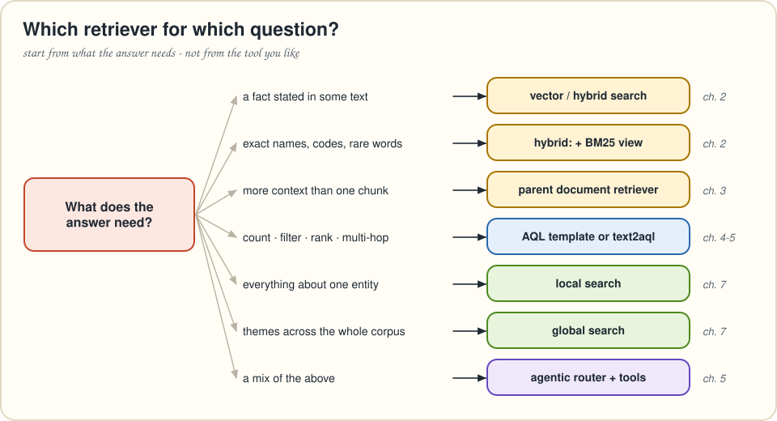
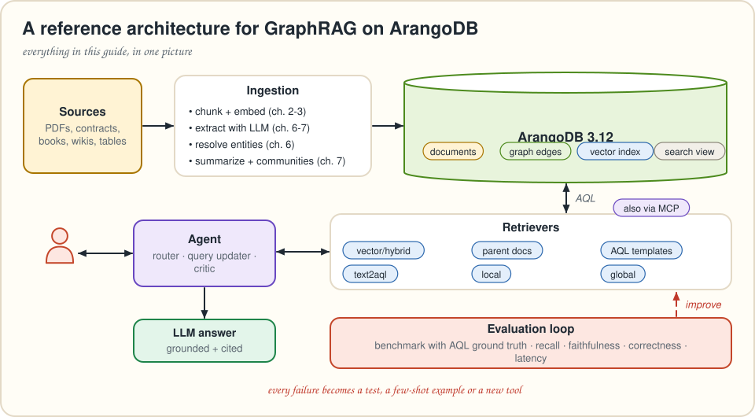

# Chapter 9 · The big picture

> *New in this guide: a synthesis of the book's design and architecture, mapped onto ArangoDB.*

You've built every major retrieval pattern in *Essential GraphRAG*. This chapter steps back: **which pattern for which question**, **how the pieces fit into one system**, and **what changes when you go to production**.

---

## Which retriever for which question?



The book's arc has a clear lesson: **start from what the answer needs, not from the tool you like.**

* Facts that sit in *some paragraph* → **vector search** (chapter 2). Add **BM25 hybrid** when users type names, codes and rare words.
* Answers that need *more than a chunk* → **parent document retrieval** (chapter 3), with **step-back** rewriting if questions are too specific to match.
* Anything that needs **counting, filtering, ranking or several hops** → an **AQL template** if you've seen the pattern before, **text2aql** if you haven't (chapters 4–5).
* Everything about **one entity** → **local search** (chapter 7).
* **Themes** across a corpus → **global search** (chapter 7).
* All of the above, from the same chat box → an **agentic router** (chapter 5) that picks among them, plus a critic.

## How the pieces fit



| Layer | What it does | Book chapters | ArangoDB features |
|---|---|---|---|
| **Ingestion** | chunk, embed, extract entities, resolve duplicates, summarize, detect communities | 2, 3, 6, 7 | `INSERT … OPTIONS { overwriteMode }`, `UPSERT`, deterministic `_key`s, unique persistent indexes |
| **Storage** | text, structure and vectors side by side | 1, 2, 6, 7 | document & edge collections, named graphs, **vector index**, **ArangoSearch view** |
| **Retrieval** | the six retrievers | 2–5, 7 | `APPROX_NEAR_COSINE`, `SEARCH … BM25()`, traversals `FOR v IN 1..n OUTBOUND`, `COLLECT … AGGREGATE`, subqueries |
| **Orchestration** | route, rewrite, criticize, answer | 3, 5 | bind parameters (safe tool arguments), read-only users |
| **Evaluation** | benchmark, metrics, latency | 8 | AQL ground truth, `COLLECTION_COUNT`, any query as an oracle |

### One query to rule them all?

ArangoDB's party trick is that one AQL query can mix every retrieval style. For example, *"what do recent contracts with companies in Texas say about payment?"*:

```aql
FOR org IN organizations
  FOR location IN 1..1 OUTBOUND org located_at
    FILTER location.state == "Texas"
    FOR contract IN 1..1 OUTBOUND org has_party
      FILTER contract.effective_date >= "2024-01-01"
      FOR chunk IN 1..1 OUTBOUND contract has_chunk
        LET score = COSINE_SIMILARITY(chunk.embedding, @question_embedding)
        SORT score DESC
        LIMIT 5
        RETURN { party: org.name, contract: contract._key, text: chunk.text, score }
```

Graph traversal narrows the candidates and vectors rank what's left, in one round trip. Use this power deliberately. A clear retriever per question type is easier to test (chapter 8) than one clever mega-query.

---

## GraphRAG pipeline or Graph + MCP?

Chapter 5's bonus served the retrievers over MCP. When should an agent drive the database, and when should your pipeline?

| | Fixed GraphRAG pipeline | Agent + MCP tools |
|---|---|---|
| **Who decides what to retrieve** | your code (fixed steps) | the model, step by step |
| **Latency & cost** | predictable, low | variable, higher |
| **Best for** | product features, support bots, high volume | analysts, exploration, unanticipated questions |
| **Main risk** | rigid: questions it wasn't designed for | wandering, expensive or unsafe queries |
| **Mitigation** | a router with a text2aql fallback | narrow read-only tools, timeouts, query budgets |

The common pattern combines them: expose your **best GraphRAG retrievers as tools** (local search, global search, the AQL templates) next to a guarded text2aql tool. The agent gets reliable context in one call and can still dig deeper.

---

## Production checklist

**Data & indexing**
- [ ] Server started with `--vector-index`. Vector index created **after** loading data (required up to 3.12.8).
- [ ] `nLists` between √N and 4·√N (ArangoDB's default from 3.12.10), and `nProbe` tuned on a recall test, not guessed.
- [ ] Imports are **idempotent** (content-derived `_key`s, `overwriteMode`, `UPSERT`).
- [ ] Unique indexes on natural keys (`name`, `full_address`). An index on every `UPSERT` lookup attribute.
- [ ] Re-embed and **rebuild the vector index** when the embedding model changes.

**Safety**
- [ ] LLM-generated AQL runs as a **read-only user**, with `max_runtime` and `memory_limit`.
- [ ] Tools take **bind parameters**. Never paste user text into AQL strings.
- [ ] Prompt-injection awareness: retrieved text is *data*. Keep instructions in the system prompt.

**Quality**
- [ ] A benchmark with **AQL ground truth** in CI. Every bug becomes a row.
- [ ] Watch **context recall** first. Faithfulness alone can look great while answers are wrong.
- [ ] Log tool choices, arguments, latencies and token counts per question.

**Cost**
- [ ] Specialized templates for frequent questions (one LLM call fewer than text2aql).
- [ ] Cheap models for extraction, summaries and judging. Strong models where it matters.
- [ ] Cache extraction and summaries by content hash. Re-index only what changed.

**Licensing**
- [ ] ArangoDB 3.12.5+ Community Edition includes the former Enterprise features but has a **100 GiB dataset limit** and **no commercial production use**. Check that your use fits, or plan for the Enterprise Edition or Arango's managed platform.

---

## 📌 Key Takeaways (of the whole guide)

* LLMs are **readers, not databases**. RAG gives them the facts, and a **knowledge graph** makes those facts precise, connected and explainable.
* Start with **vectors and hybrid search**, improve retrieval with **step-back** and **parent documents**, add **text2aql** and **templates** for structured questions, and wrap them in an **agent**.
* Build graphs from text with **structured outputs** (known schema) or **MS GraphRAG** (open schema, summaries, communities).
* **Measure** everything with a benchmark whose ground truth is a query.
* ArangoDB runs all of it in **one engine with one language**: documents, graphs, full-text and vectors in AQL.

## ✏️ Pencil Time: design one

You're asked for an assistant over **support tickets** (text), **customers and contracts** (tables) and **product docs** (text). Sketch: collections and edges, retrievers, the router's tools, and three benchmark rows.

<details>
<summary>▸ One possible answer</summary>

* **Collections:** `customers`, `contracts`, `products`, `tickets` (text + embedding), `doc_chunks` (text + embedding). **Edges:** `has_contract` (customer→contract), `covers` (contract→product), `opened_by` (ticket→customer), `about` (ticket→product, extracted by an LLM), `has_chunk` (product→doc_chunks).
* **Retrievers:** hybrid search over `doc_chunks` ("how do I configure X?"), an AQL template `open_tickets_for(customer)`, an AQL template `contract_status(customer)`, text2aql as a catch-all, and local search around a product entity for "what's going on with X?".
* **Benchmark rows:** "How many open tickets does Acme have?" → `FOR t IN 1..1 INBOUND "customers/acme" opened_by FILTER t.status == "open" COLLECT WITH COUNT INTO n RETURN n`. "How do I reset a GraphLens API key?" → `RETURN "steps from doc chunk X"`. "What's the weather?" → `RETURN "out of scope"`.

</details>

---
[← Chapter 8](08-evaluation.md) · [Contents](../README.md) · [Appendix A →](appendix-a-arangodb-environment.md)
