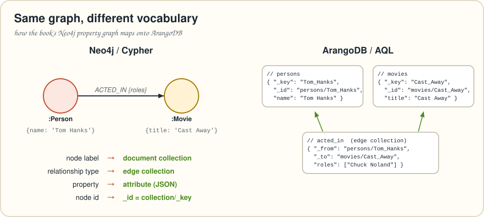

# Appendix B · Cypher ⇄ AQL phrasebook

> *New in this guide. Every pattern the book uses in Cypher, and how to say it in AQL.*

## The mental model

**Cypher draws patterns. AQL writes loops.** A Cypher `MATCH` describes a shape and lets the database find all matches. An AQL query is a pipeline of `FOR` loops, each producing rows for the next line: `FILTER`, `LET`, `SORT`, `LIMIT`, `COLLECT`, `RETURN`. Once you read `FOR v IN 1..1 OUTBOUND start edges` as "for every neighbor `v` reachable by one `edges` hop from `start`", most translations become mechanical.

## Reading

| Cypher | AQL |
|---|---|
| `MATCH (p:Person) RETURN p.name` | `FOR p IN persons RETURN p.name` |
| `MATCH (p:Person {name: 'Tom Hanks'})` | `FOR p IN persons FILTER p.name == "Tom Hanks"` |
| `WHERE p.born < 1940` | `FILTER p.born != null AND p.born < 1940` ⚠️ see *nulls* below |
| `MATCH (p)-[:ACTED_IN]->(m)` | `FOR m IN 1..1 OUTBOUND p acted_in` |
| `MATCH (m)<-[:ACTED_IN]-(p)` | `FOR p IN 1..1 INBOUND m acted_in` |
| `MATCH (a)-[:KNOWS]-(b)` (either direction) | `FOR b IN 1..1 ANY a knows` |
| `MATCH (p)-[r:ACTED_IN]->(m) RETURN r.roles` | `FOR m, r IN 1..1 OUTBOUND p acted_in RETURN r.roles` |
| `-[:KNOWS*1..3]->` | `FOR v IN 1..3 OUTBOUND a knows` |
| several relationship types `-[:DIRECTED\|PRODUCED]->` | `FOR m IN 1..1 OUTBOUND p directed, produced` |
| `shortestPath((a)-[*]-(b))` | `FOR v IN ANY SHORTEST_PATH a TO b knows RETURN v` |
| `OPTIONAL MATCH (m)<-[:DIRECTED]-(d) … collect(d.name)` | `LET directors = (FOR d IN 1..1 INBOUND m directed RETURN d.name)` |
| `ORDER BY x DESC` | `SORT x DESC` |
| `SKIP 10 LIMIT 5` | `LIMIT 10, 5` |
| `RETURN DISTINCT x` | `RETURN DISTINCT x` |
| `count(*)` grouped by x | `COLLECT x = … WITH COUNT INTO n` |
| `collect(x)` grouped by k | `COLLECT k = … INTO xs = x` |
| `avg(r.rating)` grouped by k | `COLLECT k = … AGGREGATE avg = AVERAGE(r.rating)` |
| `max(score)` per node (dedupe) | `COLLECT key = … AGGREGATE score = MAX(score)` |
| `UNWIND $rows AS row` | `FOR row IN @rows` |
| `CALL { … UNION … }` | `FOR x IN UNION((FOR … RETURN …), (FOR … RETURN …))` |
| `count {(c)<-[:IN_COMMUNITY]-()}` | `LENGTH(FOR e IN 1..1 INBOUND c in_community RETURN 1)` |
| `size(list)`, `size(string)` | `LENGTH(list)`, `CHAR_LENGTH(string)` |
| `toLower(s) CONTAINS $x` | `CONTAINS(LOWER(s), LOWER(@x))` |
| `s STARTS WITH 'The'` | `STARTS_WITH(s, "The")` |
| `exists(n.prop)` / `n.prop IS NOT NULL` | `HAS(n, "prop")` / `n.prop != null` |
| `id(n)`, `elementId(n)` | `n._id` (`"collection/key"`) |
| `$param` | `@param` (values) · `@@collection` (collection names) |

## Writing

| Cypher | AQL |
|---|---|
| `CREATE (p:Person {name: $n})` | `INSERT { name: @n } INTO persons` |
| `MERGE (p:Person {name: $n}) ON CREATE SET p.born = $b` | `UPSERT { name: @n } INSERT { name: @n, born: @b } UPDATE {} IN persons` |
| `MERGE` on a known id | `INSERT { _key: @k, … } INTO c OPTIONS { overwriteMode: "replace" }` (or `"update"`, `"ignore"`) |
| `MERGE (a)-[:R]->(b)` | `UPSERT { _from: a._id, _to: b._id } INSERT { _from: a._id, _to: b._id } UPDATE {} IN r` |
| `SET n.prop = $v` | `UPDATE n WITH { prop: @v } IN coll` |
| `SET n += $map` | `UPDATE n WITH @map IN coll` |
| list append `n.descriptions + $d` | `UPDATE n WITH { descriptions: PUSH(n.descriptions, @d) } IN coll` (or `UNION_DISTINCT`) |
| `DELETE n` / `DETACH DELETE n` | `REMOVE n IN coll` (+ remove its edges, or delete through the named-graph API, which does that for you) |
| `randomUUID()` | `UUID()` |

> [!WARNING]
> ⚠️ **One write per collection per query.** AQL lets a query write to many collections, but each collection only once, and you can't read a collection after writing it in the same query. Chain subqueries (`LET x = (INSERT … RETURN NEW)`) and write each collection once, as chapters 3, 6 and 7 do.

## Indexes and schema

| Neo4j | ArangoDB |
|---|---|
| `CREATE CONSTRAINT … REQUIRE n.name IS UNIQUE` | `col.add_index({"type": "persistent", "fields": ["name"], "unique": True})`, or make it the `_key` |
| `CREATE VECTOR INDEX … ON c.embedding` | `col.add_index({"type": "vector", "fields": ["embedding"], "params": {"metric": "cosine", "dimension": 1536, "nLists": …}})` (server needs `--vector-index`; load data first) |
| `db.index.vector.queryNodes('idx', k, $v)` | `FOR c IN col SORT APPROX_NEAR_COSINE(c.embedding, @v) DESC LIMIT k RETURN c` |
| `CREATE FULLTEXT INDEX … ON EACH [c.text]` | ArangoSearch view: `db.create_arangosearch_view("v", {"links": {"col": {"fields": {"text": {"analyzers": ["text_en"]}}}}})` |
| `db.index.fulltext.queryNodes('idx', $q)` | `FOR d IN v SEARCH ANALYZER(d.text IN TOKENS(@q, "text_en"), "text_en") SORT BM25(d) DESC` |
| `apoc.meta.data()` | sample with `ATTRIBUTES()`, `TYPENAME()`, `PARSE_IDENTIFIER()` (chapter 4) |
| GDS `gds.louvain.write` | export edges with AQL → `networkx.community.louvain_communities` → write back (chapter 7) |

## Semantics that differ

* **Nulls compare.** In AQL, `null` is *less than* every number and string: `null < 1940` is `true`. In Cypher it's `null`, so the row disappears. Guard `<` and `<=` comparisons with `!= null`.
* **Missing attributes are `null`.** `doc.no_such_attr` is `null`, not an error, in both languages, but see the previous point.
* **Ranges can count down.** `0..LENGTH(@list) - 1` on an empty list gives `[0, -1]`. Loop over values (`FOR x IN @list`) when the list may be empty.
* **Pairs counted once.** Cypher's `WHERE p1 <> p2` counts each pair twice (A,B and B,A). In AQL, `FILTER p1._key < p2._key` keeps one.
* **Collections must be declared for traversals in a cluster**: start the query with `WITH coll1, coll2` when you traverse anonymous edge collections. Single servers don't require it.

---
[← Appendix A](appendix-a-arangodb-environment.md) · [Contents](../README.md) · [Appendix C →](appendix-c-translation-notes.md)
